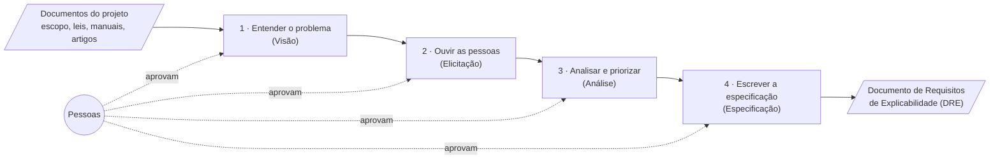

# 00 — A plataforma em linguagem simples

> Este capítulo não pressupõe conhecimento de programação. Ele conta, como uma história, o
> que acontece com um projeto dentro da plataforma, o que a IA faz, o que as pessoas decidem
> e onde a teoria OpenUPExp ainda precisa ser confirmada. Os detalhes técnicos ficam nos
> capítulos seguintes.

## 0.1 Em uma frase

A plataforma conduz um projeto pelas quatro etapas do OpenUPExp. Em cada uma, a IA prepara
uma proposta e **a equipe revisa, comenta, decide e aprova** — exatamente nos pontos em que
o BPMN da teoria prevê decisões humanas.

## 0.2 O caminho de um projeto

| Etapa | O que a IA prepara | Onde as pessoas entram | O que sai |
|---|---|---|---|
| **1 · Visão** | Problema de explicabilidade, stakeholders, necessidades, posicionamento, requisitos complementares (com citações de leis), limites e glossário | O Engenheiro de Requisitos revisa e **aprova** ou pede para refazer 1.1 ou 1.2 | Documento de Visão |
| **2 · Elicitação** | Roteiro de conversas por stakeholder; depois, a extração das necessidades a partir do material das entrevistas e a escrita dos requisitos | O Engenheiro **conduz as conversas e envia o material**; a equipe faz o **consenso**; o Engenheiro aprova | Requisitos consolidados |
| **3 · Análise** | Caracterização, aspectos explicativos, tipos de explicação, conflitos, dependências, viabilidade e **sugestão** de prioridade (MoSCoW) | **Consenso** da equipe (inclusive sobre as prioridades) e aprovação | Requisitos analisados |
| **4 · Especificação** | Histórias de usuário, critérios de aceitação, características da explicação e matriz de rastreabilidade | **Consenso** e aprovação | DRE completo |

Ao fim de cada etapa aprovada, a plataforma monta o documento daquela etapa e o soma aos
anteriores. No fim, o DRE reúne Visão, Elicitação, Análise e Especificação.

## 0.3 Como é usar, na prática

1. **A engenheira cria o projeto** e envia os documentos: o escopo (obrigatório) e, se quiser,
   leis, manuais e artigos. A plataforma prepara esses documentos para consulta.
2. **Clica em "Começar" na etapa 1.** A IA executa as tarefas do BPMN uma a uma. A tela
   mostra o diagrama da teoria colorido pelo andamento e, ao lado, o passo a passo.
3. **A plataforma avisa quando é a vez dela** ("Agora é com você: revise e aprove"). Ela lê o
   documento, confere a verificação automática e:
   - **aprova**, e a etapa fica pronta; ou
   - **pede para a IA refazer** uma parte (por exemplo, a 1.2), explicando o que mudar. O
     comentário vai para a IA, e só a parte escolhida — e o que depende dela — é refeita.
4. **Na etapa 2**, a plataforma propõe um roteiro de conversas e **pausa** até a engenheira
   enviar as transcrições ou anotações. A IA extrai as necessidades de cada pessoa, **sempre
   citando um trecho literal** do material.
5. **Nas etapas 2 a 4**, antes da aprovação há uma **rodada de consenso**: cada participante
   registra "concordo", "concordo com observações" ou "discordo", com comentários. A
   engenheira encerra a rodada ou pede ajustes.
6. **No fim de cada etapa**, o documento pode ser baixado, e a etapa seguinte começa a partir
   do que foi aprovado.

## 0.4 O que vem da teoria e o que é interpretação

| Vem da teoria [TEORIA] | Foi interpretado pela equipe [PROPOSTA] |
|---|---|
| As quatro etapas, seus subprocessos e tarefas (BPMN) | O formato exato de vários artefatos que ainda não têm template (plano de elicitação, requisito refinado, história de usuário, critérios, características) |
| Os pontos de aprovação e o retorno a X.1 ou X.2 (anotação dos gateways) | A regra de fechamento do consenso ("sem objeção bloqueante") e quem participa |
| As listas de aspectos explicativos, tipos de explicação, critérios de viabilidade e MoSCoW (tarefa de Análise) | Que a IA **apenas sugere** a prioridade, e as pessoas decidem |
| Os passos e boas práticas de cada tarefa | Os itens da verificação automática antes de cada aprovação |

Todas as interpretações estão listadas, com a justificativa e o trecho da teoria em que se
apoiam, no **[capítulo 12](12-decisoes-pendentes.md)**. Elas foram feitas para permitir testar
o processo inteiro agora, e podem ser trocadas quando a autora decidir — sem refazer a
plataforma.

## 0.5 Como a IA é mantida "honesta"

- **Não inventar.** Todos os pedidos aos agentes trazem as mesmas regras: usar só as
  entradas, não completar o que falta por suposição, não decidir o que cabe às pessoas.
- **Dizer o que falta.** Quando uma informação não está nas entradas, a IA registra uma
  **lacuna** com uma pergunta sugerida para os stakeholders.
- **Provar o que cita.** Citações de leis, manuais e entrevistas são **conferidas
  mecanicamente** contra o texto original; a tela mostra se a citação foi encontrada.
- **Deixar rastro.** Cada item aponta para sua origem (de qual necessidade veio um requisito,
  de qual requisito veio uma história). A matriz de rastreabilidade da etapa 4 é **calculada**
  a partir desses vínculos, não escrita pela IA.
- **Mostrar o que leu.** Em cada tarefa é possível ver exatamente o material que a IA recebeu.

## 0.6 O problema do "contexto"

Uma preocupação inicial do projeto era que o documento cresce a cada etapa e, se a IA
recebesse o documento inteiro em toda tarefa, ficaria cara, lenta e mais propensa a erros.

A plataforma resolve isso entregando a cada tarefa **só o que ela precisa**: as entradas
declaradas no manifesto (por exemplo, só os stakeholders e as necessidades), resumos das
etapas anteriores e os comentários das pessoas. Quando a tarefa precisa ver *todos* os
itens (por exemplo, priorizar todos os requisitos), uma verificação automática garante que
nenhum ficou de fora.

Há quatro formas de montar esse material, que a pesquisa compara:

| Estratégia | Em palavras simples |
|---|---|
| **A · Tudo** | Entradas + o documento inteiro |
| **B · Por semelhança** | Só os itens mais parecidos com a tarefa (pode deixar itens de fora — e isso é medido) |
| **C · Só as entradas** | Exatamente o que o manifesto declara |
| **D · Equilibrada** (padrão) | C + resumos das etapas anteriores + comentários das pessoas |

## 0.7 Modelos de IA e o modelo local

A plataforma pode usar modelos de vários fornecedores (OpenAI, Google, Groq, Anthropic). Um
administrador cadastra os modelos, testa se respondem no formato certo e escolhe o padrão.

Existe também um **modelo local** (Qwen3 4B), que roda no próprio computador ou em um servidor
da instituição, sem enviar documentos para fora. Ele é **opcional**: sem placa de vídeo, é
lento e pesado, então só é ligado quando alguém escolhe. Mais detalhes no
[capítulo 14](14-modelos-e-laboratorio.md).

## 0.8 O laboratório e a pesquisa

O **Laboratório de modelos** refaz uma mesma tarefa já executada com outros modelos ou outras
estratégias de contexto, **com exatamente o mesmo material de entrada**. Assim, a diferença nos
resultados vem do modelo (ou da estratégia), não de outro fator.

Para cada tentativa, a plataforma mostra: se a resposta veio no formato certo, quantos itens
produziu, quantas lacunas, quantas citações foram confirmadas, o custo e o tempo. Com um
**gabarito** — a lista de itens que uma resposta correta deveria conter, feita por
especialistas — ela calcula também precisão, cobertura e F1. Cada pessoa pode dar uma nota
de 1 a 5, e os dados podem ser exportados para análise estatística.

Uma pergunta de pesquisa possível (ainda **proposta**, a decidir pela pesquisadora e pela
autora): *até que ponto modelos pequenos, executados localmente, produzem artefatos de
requisitos de explicabilidade comparáveis aos de modelos comerciais, sob diferentes
estratégias de contexto?*

## 0.9 Como a autora pode contribuir

1. **Responder às perguntas do [capítulo 12](12-decisoes-pendentes.md).** Cada pergunta já traz
   a interpretação que adotamos; muitas vezes basta confirmar ou indicar a alternativa.
2. **Conferir os formatos provisórios** das etapas 2 a 4, de preferência usando a própria
   plataforma em modo de teste (sem IA e sem custo).
3. **Ajudar a montar gabaritos** para o laboratório, com outros especialistas, sem ver as
   respostas da IA.
4. **Corrigir pequenos pontos do BPMN** listados no cap. 01 (nomes com erro de digitação,
   fluxos de retorno só como anotação) — nenhum deles bloqueia a plataforma.

## 0.10 Próximos passos

- Conduzir um projeto inteiro (INPI) com IA real, do início ao fim.
- Substituir as interpretações provisórias pelas decisões da autora.
- Gabaritos feitos por especialistas e um segundo e terceiro estudos de caso, em outros domínios.
- Comparações no laboratório com repetições suficientes para análise estatística.
