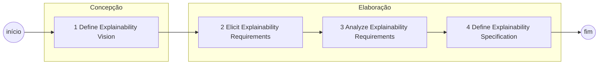
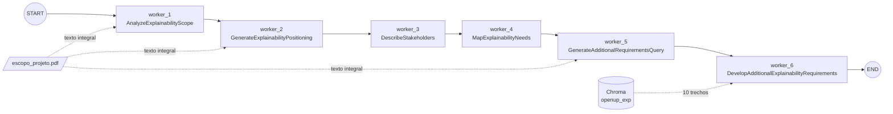

# 01 — Teoria e estado atual

## 1.1 O que a teoria define [TEORIA]

### Estrutura do processo

O processo OpenUPExp (`OpenUPExp Process.bpmn`) é composto por quatro macroatividades
sequenciais, executadas na *lane* **Requirements Engineer**. Cada macroatividade segue o
padrão *Prepare → Develop/Elicit/Analyze/Specify → Validate*.

| Fase OpenUP | Macroatividade | Subprocessos | Artefato de saída (data object) |
|---|---|---|---|
| Concepção | 1 Define Explainability Vision | 1.1 Prepare · 1.2 Develop · 1.3 Validate | *Explainability Vision* |
| Elaboração | 2 Elicit Explainability Requirements | 2.1 Prepare · 2.2 Elicit · 2.3 Validate | *Explainability Requirement Document (ERD)* |
| Elaboração | 3 Analyze Explainability Requirements | 3.1 Prepare · 3.2 Analyze · 3.3 Validate | *ERD* (com *Analyzed Explainability Requirements*) |
| Elaboração | 4 Define Explainability Specification | 4.1 Prepare · 4.2 Specify · 4.3 Validate | *ERD* (com *Specified Explainability Requirements*) |

A associação Concepção ↔ macroatividade 1 e Elaboração ↔ macroatividades 2–4 vem de
`ciclo de vida/Fase Concepção.md` e `ciclo de vida/Fase Elaboração.md`.

### Pontos de decisão e interação humana

| Elemento BPMN | Tipo | Comportamento definido |
|---|---|---|
| `Explainability Vision approved?` (1.3) | Gateway exclusivo | *Yes* → 1.3.2 Consolidate. Anotação: *"Requirements Engineer decides whether to revisit subprocess 1.1 or 1.2 based on the identified issue"* |
| `Explainability Requirements approved?` (2.3) | Gateway exclusivo | Idem, revisitando 2.1 ou 2.2 |
| `Explainability Analysis approved?` (3.3) | Gateway exclusivo | Idem, revisitando 3.1 ou 3.2 |
| `Specification approved?` (4.3) | Gateway exclusivo | Idem, revisitando 4.1 ou 4.2 |
| 2.2.5 Reach Consensus | Tarefa | Produz *Consolidated Explainability Requirements* |
| Reach Consensus (3.2, sem número) | Tarefa | Produz *Analyzed Explainability Requirements* |
| 4.2.5 Reach Consensus | Tarefa | Produz *Specified Explainability Requirements* |

### Base de conhecimento

O *data store* **Explainability Reference Base** aparece em 1.2.2, 2.2.3 e 3.2.2. É a
base de referência (normas, leis, literatura de XAI) que, no executável, corresponde ao
corpus RAG.

### Papéis [TEORIA]

`papeis/` define: Engenheiro de Requisitos (único com descrição detalhada), Arquiteto de
Software, Desenvolvedor, Especialista de Domínio, Especialista em IA, Especialista em
Regulação, Gerente de Projeto, Testador e Stakeholders (arquivo vazio). No BPMN, **apenas
a lane Requirements Engineer existe**; os demais papéis aparecem apenas nas tarefas
textuais (campo "Quem").

### Templates e artefatos [TEORIA]

| Arquivo | Estado |
|---|---|
| `artefatos/visao-explicabilidade.md` | Template do Documento de Visão (seções 1–5) — **completo** |
| `artefatos/DRE.md` | Visão + checklist "Limite da Explicabilidade" + esqueleto de Glossário |
| `artefatos/glossario.md` | **vazio** |
| `templates/documento-visao-template.md` | **vazio** |
| `templates/tarefas-template.md`, `templates/artefatos-template.md` | **vazios** |
| `templates/README.md` | Template de descrição de tarefa (passos) |
| `tarefas/definir-visao.md` | 7 passos da tarefa Definir a Visão |
| `tarefas/encontrar-descrever-requisitos.md` | 7 passos (elicitação) |
| `tarefas/analisar-requisito.md` | 8 passos (análise) |
| `tarefas/especificar-requisitos.md` | 6 passos (especificação) |

## 1.2 Inconsistências encontradas na teoria [PENDENTE-AUTORA]

Encontradas na leitura dos arquivos. Não são críticas à teoria; são pontos que precisam
ser resolvidos antes de serem codificados.

| ID | Inconsistência | Evidência | Impacto na implementação |
|---|---|---|---|
| I-01 | Os gateways só têm o fluxo **Yes** modelado; o retorno (No → 1.1/1.2) existe apenas como anotação | `1.3/2.3/3.3/4.3 *.bpmn`: o gateway tem 1 `outgoing` | O roteamento de retorno precisa ser definido no manifesto, não pode ser lido do BPMN |
| I-02 | Fluxos de sequência de 1.1 e 1.2 referenciam IDs inexistentes no XML | ex.: `1.1 Prepare…bpmn`, `sourceRef=a28398ba-…` sem elemento correspondente | A ordem 1.1.1→…→1.1.5 só é inferível pela numeração ou pelo SVG |
| I-03 | Duas decomposições não equivalentes da Visão: 7 passos em `definir-visao.md` × 9 tarefas BPMN (1.1.1–1.2.4) | ex.: o passo "Declaração de Posicionamento (2.2)" não tem tarefa BPMN correspondente | Mapeamento passo ↔ tarefa precisa de validação (cap. 02) |
| I-04 | Nome do documento final: DRE (pt) × ERD (en); `DRE.md` também é expandido como "Documento de Referência de Especificação" | `artefatos/DRE.md` linha 1 × `tarefas/*.md` | Nome canônico do tipo de artefato |
| I-05 | Composição do ERD ao longo das fases não definida (DRE.md só contém Visão + Glossário) | `artefatos/DRE.md` | Não é possível definir o contrato do ERD nas fases 2–4 |
| I-06 | "1.1.3 Identify Stakeholder Needs" × "1.2.1 Identify Explainability Needs": diferença conceitual não explicitada | `1.1/1.2 *.bpmn` | Risco de dois agentes produzirem o mesmo conteúdo |
| I-07 | Tarefa "Reach Consensus" em 3.2 sem número; erros de digitação ("3.1.2Consolidate", "4.3.2 .Consolidate", "Draf", "Complemenatary", "assesses", "dependecies") | `3.2/3.1/4.3 *.bpmn` | Os IDs do manifesto devem usar o ID BPMN, não o nome |
| I-08 | Os participantes do consenso não são modelados (lane única) | todos os `.bpmn` | Papéis e regra de consenso não definidos (cap. 07) |
| I-09 | `Fase Elaboração.md` aponta para artefatos inexistentes (`explainability-needs.md`, `refined-explainability-requirements.md`, `user-stories.md`) | `ciclo de vida/` | Templates das fases 2–4 ausentes |
| I-10 | O template de Visão §4.1 tem a coluna "Característica/Aspecto Associado"; `analisar-requisito.md` passo 2 classifica aspectos na Análise | `artefatos/visao-explicabilidade.md` × `tarefas/analisar-requisito.md` | Em que fase o aspecto é atribuído? |
| I-11 | `visao-explicabilidade.md` §3.1 menciona "informações produzidas pelos **Workers** anteriores" | `artefatos/visao-explicabilidade.md` | Vocabulário da implementação dentro do template teórico |
| I-12 | O export Bizagi (`bizagi-publish/js/json/configuration.json.js`) não contém os elementos das páginas folha (1.1, 1.2, …) | página com `elements` vazio | O portal Bizagi não serve como fonte de dados; os `.bpmn` sim |

## 1.3 O que está implementado [IMPLEMENTADO]

### Grafo atual

| Worker | Função BAML | Entrada efetiva | Saída no blackboard |
|---|---|---|---|
| W1 | `AnalyzeExplainabilityScope` | escopo integral | `visao_explicabilidade.escopo` |
| W2 | `GenerateExplainabilityPositioning` | W1 + escopo integral | `.posicionamento` |
| W3 | `DescribeStakeholders` | W2 | `.stakeholders` |
| W4 | `MapExplainabilityNeeds` | W3 | `.necessidades_funcionalidades` |
| W5 | `GenerateAdditionalRequirementsQuery` | escopo + **Markdown inteiro compilado** | `.consulta_requisitos_adicionais` |
| W6 | `DevelopAdditionalExplainabilityRequirements` | W1–W4 integrais + 10 chunks | `.conhecimento_recuperado`, `.requisitos_adicionais_explicabilidade` |

Persistência: `blackboard.json` e `Documento_de_Visao_Explicabilidade_Parcial.md`,
sobrescritos a cada execução. LLM: cliente `ResilientBlackboardLLM` (fallback).
RAG: Chroma persistente, `paraphrase-multilingual-MiniLM-L12-v2`, chunks de 1000
caracteres com sobreposição de 150.

### Tamanho real do contexto (medido)

| Item | Tamanho |
|---|---|
| Escopo do projeto (texto extraído do PDF) | ≈ 2,4 KB |
| `blackboard.json` total | ≈ 17 KB |
| dos quais trechos RAG em `conhecimento_recuperado` | ≈ 11 KB |

**Conclusão:** o problema de contexto ainda **não se manifesta** na Fase 1. Ele surge
nas fases 2–4, quando o ERD acumula requisitos, classificações, conflitos, dependências,
prioridades, histórias, critérios de aceitação e rastreabilidade. Essa observação tem
consequência metodológica (cap. 09): comparar estratégias de contexto apenas na Fase 1
tende a não mostrar diferença.

## 1.4 Problemas técnicos no executável [IMPLEMENTADO]

| ID | Problema | Local | Consequência |
|---|---|---|---|
| P-01 | HITL comentado (`interrupt`), grafo compilado **sem checkpointer** | `main.py` | Impossível pausar e retomar |
| P-02 | Grafo puramente linear, sem `add_conditional_edges` | `main.py` | Não há retorno 1.1/1.2 |
| P-03 | O contrato do W6 não carrega evidência: o prompt exige fonte, página e trecho, mas a saída tem só `categoria`, `requisito`, `justificativa` | `baml_src/worker6.baml` | Rastreabilidade da evidência não garantida pelo tipo |
| P-04 | Trechos RAG gravados dentro do blackboard | `main.py` (`worker_6`) | Estado cresce; evidência pode ficar desatualizada |
| P-05 | O modelo de embedding lê no máximo 128 tokens por trecho; os chunks têm ~250 tokens | `indexar_documentos.py`, `rag_retriever.py` | Cerca de metade de cada chunk não é representada no vetor |
| P-06 | Chunking por número de caracteres, ignorando a estrutura (artigos, seções) | `indexar_documentos.py` | Artigos de lei separados do contexto |
| P-07 | Busca apenas vetorial | `rag_retriever.py` | Consultas como "Art. 20 da LGPD" dependem de correspondência lexical |
| P-08 | A indexação recria a coleção inteira a cada execução | `indexar_documentos.py` | Sem versionamento do corpus; sem atualização incremental |
| P-09 | Fallback com o mesmo modelo: `GroqLlama70B` e `GroqLlama8B` usam `openai/gpt-oss-20b`; `gemini-1.5-flash` descontinuado | `baml_src/clients.baml` | Redundância apenas aparente |
| P-10 | `"\\n"` literal em `print` e no texto gerado | `main.py` (W5, W6, compilador) | `\n` escrito no documento |
| P-11 | Sem `generators.baml` no `baml_src/` | `baml_src/` | `baml_client/` (v0.226.2) não pode ser regenerado de forma reprodutível |
| P-12 | Sem `pyproject.toml`/`requirements.txt` | raiz | Versões de LangGraph, BAML e Chroma não fixadas |
| P-13 | W4 removeu de propósito o campo "aspecto associado" que existe no template | `baml_src/worker4.baml` | Divergência consciente; ver I-10 |
| P-14 | `main_15_10.py` e `main_teste.py` são versões antigas e divergentes | raiz | Ruído; `main_teste.py` não executa (usa `b` sem importar) |
| P-15 | PDFs do corpus e `chroma_db/` versionados no Git | raiz | Repositório pesado; índice binário versionado |
