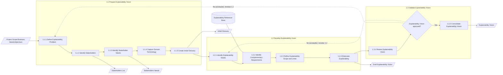
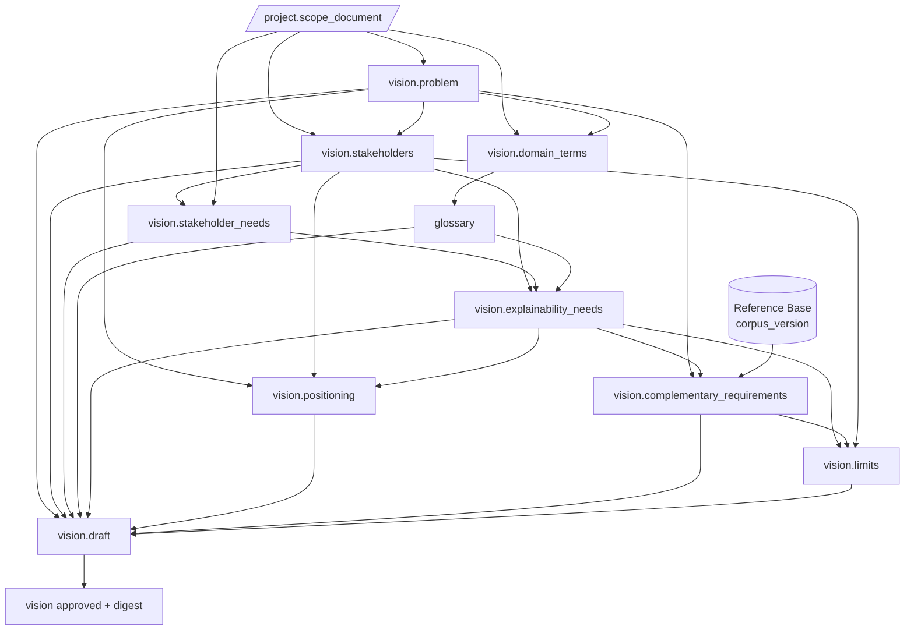
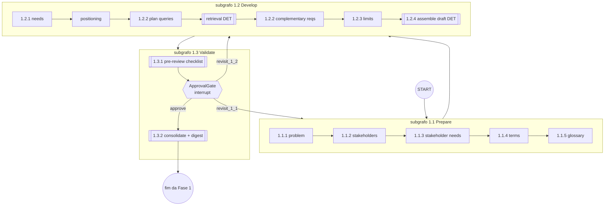

# 02 — Fase 1 (Visão), tarefa por tarefa

> **Em poucas palavras.** Para cada tarefa do BPMN da Visão, este capítulo mostra o passo
> correspondente no texto da tarefa (`definir-visao.md`), quem executa (IA, automático ou
> pessoa), o que entra, o que sai e qual seção do template de Visão é preenchida. Foi o mapa
> usado para construir a Etapa 1, que hoje funciona de ponta a ponta [IMPLEMENTADO].


Este capítulo relaciona, para cada elemento BPMN da macroatividade
**1 Define Explainability Vision**:

- o passo textual correspondente da tarefa;
- o worker atual;
- o worker proposto;
- o contrato BAML;
- as entradas e saídas;
- a seção do template;
- o mecanismo humano envolvido.

## 2.1 Fluxo da Fase 1 segundo o BPMN [TEORIA]



Observações [PENDENTE-AUTORA]:

- **Ordem das tarefas (I-02):** em 1.1 e 1.2, os fluxos de sequência do XML apontam para
  IDs inexistentes. A ordem acima foi inferida pela numeração e precisa ser confirmada
  com o diagrama original.
- **Retorno do gateway (I-01):** o caminho *No* está pontilhado porque existe apenas
  como anotação no BPMN.

## 2.2 Tabela de mapeamento

Legenda da coluna "Mecanismo":

- **AG**: agente LLM;
- **DET**: etapa determinística (código, sem LLM);
- **HA**: aprovação humana individual;
- **HC**: consenso humano (cap. 07).

| BPMN (ID) | Tarefa | Passo textual (`definir-visao.md`) [TEORIA] | Worker atual [IMPLEMENTADO] | Worker proposto [PROPOSTA] | Mec. | Entradas (manifesto) | Saída (tipo de artefato) | Seção do template |
|---|---|---|---|---|---|---|---|---|
| `Id_d905d16a-33c7-4283-adff-653cf4956381` | 1.1.1 Define Explainability Problem | Passo 2 "Adquirir consenso sobre o problema" (parcial) | W1 `AnalyzeExplainabilityScope` | `DefineExplainabilityProblem` (evolução do W1) | AG | `project.scope_document` (integral) | `vision.problem` | §1 Definição; §2.1 Declaração do Problema |
| `Id_cacbf0a9-0ef6-4e84-97ac-1f57ea641981` | 1.1.2 Identify Stakeholders | Passo 1 "Identificar Stakeholders…" | W1 (lista `stakeholders_afetados`) + W3 `DescribeStakeholders` | `IdentifyStakeholders` | AG | `vision.problem`, `project.scope_document` | `vision.stakeholders` (itens `STK-n`) | §3.1 Resumo dos Stakeholders |
| `Id_688b9fd5-781a-4f2d-83b7-2c5b249b8a18` | 1.1.3 Identify Stakeholder Needs | Passo 4 "Obter as solicitações dos Stakeholders" | — | `IdentifyStakeholderNeeds` | AG | `vision.stakeholders`, `project.scope_document` | `vision.stakeholder_needs` (`SN-n`) | (sem seção própria — I-06) |
| `Id_2965ae2a-77fd-40a1-802f-97a3eeb0dbca` | 1.1.4 Capture Domain Terminology | Passo 3 "Capturar um vocabulário comum" | — | `CaptureDomainTerminology` | AG | `project.scope_document`, `vision.problem` | `vision.domain_terms` (intermediário) | — |
| `Id_1db0cf6b-bde5-4864-95c5-24e867d101cc` | 1.1.5 Create Initial Glossary | Passo 3 | — | `CreateInitialGlossary` | AG | `vision.domain_terms` | `glossary` (itens `TERM-n`) | DRE §2 Glossário (template vazio) |
| `Id_af892c99-ac4d-4fdf-909f-621086c03a58` | 1.2.1 Identify Explainability Needs | Passo 1 (caracterizar necessidades) | W4 `MapExplainabilityNeeds` | `IdentifyExplainabilityNeeds` | AG | `vision.stakeholders`, `vision.stakeholder_needs`, `glossary` | `vision.explainability_needs` (`NEED-n`) | §4.1 Necessidades e Aspecto Associado |
| — (sem tarefa BPMN) | Declaração de Posicionamento | Passo 1 → "Seção 2.2" | W2 `GenerateExplainabilityPositioning` | `GenerateExplainabilityPositioning` | AG | `vision.problem`, `vision.stakeholders`, `vision.explainability_needs` | `vision.positioning` (`POS-n` → `STK-n`) | §2.2 Posicionamento |
| `Id_ee223aee-e789-4b4d-9084-dd1d70483c10` | 1.2.2 Identify Complementary Requirements | Passo 5 "Identificar as restrições no sistema" | W5 `GenerateAdditionalRequirementsQuery` + W6 `DevelopAdditionalExplainabilityRequirements` | `PlanReferenceQueries` + **Retrieval (DET)** + `DevelopComplementaryRequirements` | AG + DET | `vision.problem`, `vision.explainability_needs`, Reference Base | `vision.complementary_requirements` (`CR-n`) + `evidence` | §5.1–5.5 |
| `Id_30d605ee-ff11-4002-9057-209048cb8c8e` | 1.2.3 Define Explainability Scope and Limits | Passo 6 "Definir os limites" | — | `DefineExplainabilityLimits` | AG | `vision.explainability_needs`, `vision.complementary_requirements`, `vision.stakeholders` | `vision.limits` (respostas ao checklist) | DRE "Limite da Explicabilidade" |
| `Id_04110efa-231e-4d99-bcc9-304c73317d95` | 1.2.4 Elaborate Explainability | — | `compilar_markdown_parcial` (determinístico) | `AssembleDraftVision` (DET) + `CheckVisionConsistency` (AG, opcional) | DET (+AG) | todos os `vision.*` e `glossary` em versão atual | `vision.draft` (snapshot) + export `.md` | Documento de Visão completo |
| `Id_6d97a064-9674-4754-9a95-136259d5f5fa` | 1.3.1 Review Explainability Vision | Passo 7 "Obter consenso (revisão da Visão)" | — (HITL comentado) | `PreReviewChecklist` (DET+AG) → revisão humana | DET + HA | `vision.draft` | `review_report` | — |
| `Id_d7c8e559-18d9-47d2-a3de-19db3082835a` | Gateway "Explainability Vision approved?" | Passo 7 | — | `ApprovalGate` | **HA** | `vision.draft`, `review_report` | `hitl_response` (decisão) | — |
| `Id_7e496f88-9dfe-4b59-83e4-40244ff17f02` | 1.3.2 Consolidate Explainability Vision | Passo 7 "versão aprovada" | — | `ConsolidateVision` (DET) + `BuildPhaseDigest` (AG) | DET (+AG) | `vision.draft` aprovado | `vision` (approved), export versionado, `digest.vision` | — |

### Observações sobre o mapeamento

- **Posicionamento sem tarefa BPMN [PENDENTE-AUTORA].** O W2 produz a §2.2 do template e
  o passo 1 de `definir-visao.md` manda registrá-la, mas nenhuma tarefa BPMN a produz
  explicitamente. Há três opções:
  - (a) é parte de 1.1.2;
  - (b) é parte de 1.2.4;
  - (c) falta uma tarefa no BPMN.

  A proposta trata o posicionamento como nó próprio, ligado a 1.2.4 no manifesto, até a
  autora decidir.
- **Ordem atual W2 → W3 → W4 × BPMN [PROPOSTA].** Hoje os stakeholders são descritos a
  partir do posicionamento, e as necessidades a partir das descrições. O BPMN indica a
  ordem inversa: stakeholders (1.1.2) → necessidades (1.1.3/1.2.1), com o posicionamento
  dependendo das necessidades. A proposta segue o BPMN. Isso muda a cadeia de
  dependências e precisa de validação experimental: comparar a qualidade nas duas ordens.
- **1.1.3 × 1.2.1 (I-06) [PENDENTE-AUTORA].** Interpretação de trabalho:
  - **1.1.3** registra solicitações brutas dos stakeholders, nas palavras deles e com
    origem rastreável;
  - **1.2.1** as transforma em *necessidades de explicabilidade* em nível conceitual,
    que é o que o W4 faz hoje.
- **1.3.1 Review.** A revisão é humana [TEORIA]. A etapa `PreReviewChecklist` [PROPOSTA]
  não substitui o revisor: apenas pré-calcula verificações objetivas para apoiar a
  decisão, como:
  - todo `STK` tem um `POS`;
  - todo `NEED` aponta para pelo menos um `STK`;
  - todo `CR` tem evidência verificada;
  - número de lacunas por seção.

  **[PENDENTE-AUTORA]:** a IA pode participar da revisão, ou apenas o humano?
- **§5.6 Priorização dos Outros Requisitos.** O W6 não atribui prioridade, por decisão do
  prompt [IMPLEMENTADO]. Quem prioriza na Visão: o Engenheiro, na revisão? [PENDENTE-AUTORA]
- **§3.2 Ambiente do usuário.** Não tem tarefa nem worker. Proposta: é preenchida pelo
  `IdentifyStakeholders` quando houver evidência no escopo; caso contrário, fica como
  lacuna para o Engenheiro.

## 2.3 Cobertura do template da Visão

| Seção do template [TEORIA] | Produzida hoje por [IMPLEMENTADO] | Proposta [PROPOSTA] |
|---|---|---|
| §1 Definição da Explicabilidade | W1 (campos `necessidade_de_explicabilidade`, `descricao_geral`…) | `vision.problem` |
| §2.1 Declaração do Problema (problema / afeta / impacto / solução) | **parcial** — W1 não gera a tabela | `vision.problem.problem_statement` |
| §2.2 Posicionamento por perfil | W2 | `vision.positioning` |
| §3.1 Resumo dos stakeholders | W3 | `vision.stakeholders` |
| §3.2 Ambiente do usuário | — | `vision.stakeholders.user_environment` |
| §4.1 Necessidades e Aspecto Associado | W4 (**sem** aspecto — P-13) | `vision.explainability_needs` (aspecto opcional até decisão I-10) |
| §5.1–5.5 Requisitos adicionais | W6 | `vision.complementary_requirements` |
| §5.6 Priorização | — | definição pendente |
| Limite da Explicabilidade (checklist do DRE) | — | `vision.limits` |
| Glossário | — | `glossary` |

## 2.4 Grafo de dependências entre artefatos da Fase 1 [PROPOSTA]

Este grafo é a base da **invalidação automática** (cap. 06). Quando um artefato é
substituído por uma nova versão, todos os que dependem dele ficam `stale`.



## 2.5 Grafo LangGraph proposto para a Fase 1 [PROPOSTA]

Cada subprocesso BPMN vira um **subgrafo**. O gateway é um nó de interrupção seguido de
uma aresta condicional. O estado do grafo carrega apenas referências (IDs de versões de
artefato e da solicitação HITL pendente), nunca o conteúdo.



Regras de reexecução após *revisit*:

- **`revisit_1_1`:** gera nova versão de todos os artefatos de 1.1. Os de 1.2 ficam
  `stale` e são refeitos.
- **`revisit_1_2`:** preserva as versões aprovadas/atuais de 1.1 e refaz apenas 1.2.
- O comentário do Engenheiro e as edições feitas na revisão entram no contexto dos
  workers refeitos como entrada obrigatória `review_feedback` (cap. 05).
- **Granularidade [PROPOSTA além da teoria]:** permitir que o Engenheiro escolha
  *tarefas* específicas dentro do subprocesso. O padrão segue o BPMN (subprocesso
  inteiro). A opção fina fica desligada até a autora decidir.

## 2.6 Manifesto do processo — exemplo para a Fase 1 [PROPOSTA]

O manifesto é o artefato que liga a teoria (IDs BPMN) à execução (nós, contratos,
artefatos). É versionado junto do código. Toda execução registra a versão do manifesto
usada. Um teste automatizado garante que toda tarefa e todo gateway dos `.bpmn` de
referência tenha uma entrada no manifesto, e vice-versa.

```yaml
manifest_version: "0.1.0"
process: openupexp
bpmn_source:
  repo: OpenUPExp
  path: web/bpmn
  commit: "<sha do repositório teórico>"
phases:
  - id: "1"
    name: Define Explainability Vision
    openup_phase: inception
    bpmn_element: Id_430f37ed-5aef-4b2c-af4e-59ff311e2b2e
    subprocesses:
      - id: "1.1"
        bpmn_element: Id_b3b842eb-4166-45dc-b51b-089fa06a8fdb
        tasks:
          - id: "1.1.1"
            bpmn_element: Id_d905d16a-33c7-4283-adff-653cf4956381
            name: Define Explainability Problem
            mechanism: agent
            baml_function: DefineExplainabilityProblem
            theory_ref: tarefas/definir-visao.md#passo-2
            reads:
              - artifact: project.scope_document
                select: full
                required: true
            writes:
              - artifact: vision.problem
            template_sections: ["visao §1", "visao §2.1"]
          - id: "1.1.2"
            bpmn_element: Id_cacbf0a9-0ef6-4e84-97ac-1f57ea641981
            name: Identify Stakeholders
            mechanism: agent
            baml_function: IdentifyStakeholders
            reads:
              - { artifact: vision.problem, select: full, required: true }
              - { artifact: project.scope_document, select: full, required: true }
            writes:
              - artifact: vision.stakeholders
                item_prefix: STK
      - id: "1.2"
        bpmn_element: Id_fe4680cc-f44f-45ae-862d-5bae83812c6a
        tasks:
          - id: "1.2.2"
            bpmn_element: Id_ee223aee-e789-4b4d-9084-dd1d70483c10
            name: Identify Complementary Requirements
            mechanism: agent
            baml_function: DevelopComplementaryRequirements
            reads:
              - { artifact: vision.problem, select: full, required: true }
              - { artifact: vision.explainability_needs, select: all_items, required: true }
            retrieval:
              store: reference_base
              planner: PlanReferenceQueries
              mode: hybrid
              top_k: 12
              filters: { source_kind: [lei, manual, academico] }
            writes:
              - { artifact: vision.complementary_requirements, item_prefix: CR, evidence: required }
      - id: "1.3"
        bpmn_element: Id_aa3edf0f-f1f3-4f2a-9b6a-5e591e81b352
        tasks:
          - id: "1.3.gate"
            bpmn_element: Id_d7c8e559-18d9-47d2-a3de-19db3082835a
            mechanism: hitl_approval
            decided_by_role: requirements_engineer
            reviews: vision.draft
            outcomes:
              approve:     { next: "1.3.2" }
              revisit_1_1: { next: "1.1", invalidates_from: "1.1", comment_required: true }   # [PENDENTE-AUTORA] I-01
              revisit_1_2: { next: "1.2", invalidates_from: "1.2", comment_required: true }
```
