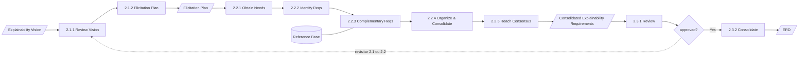
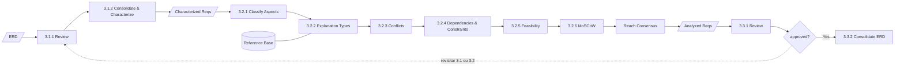
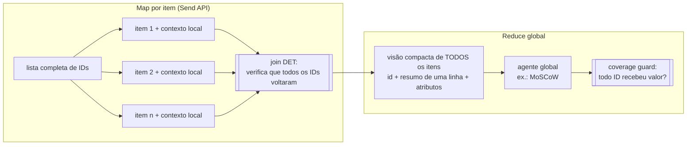

# 03 — Arquitetura preliminar das Fases 2–4

> Este capítulo é **preliminar**. As tarefas e os data objects vêm do BPMN [TEORIA]. Os
> contratos ainda não podem ser fechados porque os templates dessas fases não existem
> (I-05, I-09). Cada linha marca a dependência teórica correspondente.

## 3.1 Fase 2 — Elicit Explainability Requirements

| BPMN | Tarefa | Mec. proposto | Entradas | Saída | Dependência teórica |
|---|---|---|---|---|---|
| `Id_82a4e5fb…` | 2.1.1 Review Explainability Vision | DET (carrega digest + itens aprovados) | `vision` (approved) | — | — |
| `Id_003916cf…` | 2.1.2 Explainability Elicitation Plan | AG + HA leve (o Engenheiro ajusta o plano) | `vision`, `vision.stakeholders` | `elicitation.plan` (técnica por stakeholder, roteiro de perguntas) | **Template do plano ausente** (anotação BPMN: "Explainability Elicitation Strategy") |
| `Id_a8231a43…` | 2.2.1 Obtain Explainability Needs | **Humano + AG**: o Engenheiro conduz entrevistas e questionários e envia transcrições; o agente extrai necessidades com citação | `elicitation.plan`, `elicitation.sources` (uploads) | `elicitation.raw_needs` (`RN-n` → trecho da transcrição) | Que fontes contam como elicitação? Consentimento (LGPD) para gravações |
| `Id_9a1145e6…` | 2.2.2 Identify Explainability Requirements | AG (map por necessidade) | `elicitation.raw_needs`, `vision.explainability_needs` | `requirements.identified` (`REQ-n`) | Formato do requisito (texto livre? padrão EARS?) |
| `Id_9be0f9b6…` | 2.2.3 Identify Complementary Requirements | AG + Retrieval | `requirements.identified`, Reference Base | `requirements.complementary` (`REQ-n`, `kind=complementary`) + evidências | Diferença em relação a 1.2.2 (refinamento ou nova busca?) |
| `Id_4b45ac1c…` | 2.2.4 Organize and Consolidate Requirements | AG + **similaridade** (detecção de duplicatas) + DET (garantia de cobertura) | todos os `REQ-n` | `requirements.consolidated` (merges registrados como `trace_link`) | Regras de agrupamento |
| `Id_071a728c…` | 2.2.5 Reach Consensus | **HC** | `requirements.consolidated` | `requirements.consolidated` (versão de consenso) | Quem participa, regra de fechamento (I-08) |
| `Id_47f02f6c…` | 2.3.1 Review | DET + HA | `requirements.consolidated` | `review_report` | — |
| `Id_ac7a16bd…` | Gateway approved? | **HA** | — | decisão | I-01 |
| `Id_d27d0be5…` | 2.3.2 Consolidate Explainability Requirements | DET | — | `erd` v1 (Visão + Requisitos), digest | **Composição do ERD (I-05)** |

**Ponto arquitetural:** 2.2.1 é onde a **busca por similaridade sobre texto livre
extenso** se justifica de fato. Transcrições de entrevistas podem ter dezenas de páginas
por stakeholder e precisam ser fatiadas e recuperadas, não passadas inteiras.

## 3.2 Fase 3 — Analyze Explainability Requirements

| BPMN | Tarefa | Padrão de execução [PROPOSTA] | Completude exigida | Dependência teórica |
|---|---|---|---|---|
| `Id_a0b38e79…` 3.1.1 | Review Explainability Requirements | DET | — | — |
| `Id_bb99af25…` 3.1.2 | Consolidate and Characterize | **Map por requisito** (contexto, impacto da decisão, regulação — `analisar-requisito.md` passo 1) | todos os `REQ` | Template RER: "artefato intermediário???Validar" |
| `Id_d80a21f5…` 3.2.1 | Classify Explainability Aspects | Map por requisito; classificação múltipla permitida | todos | Taxonomia fechada? (Compreensão, Justificativa, Confiança, Auditoria, Contestação, Aprendizado) |
| `Id_abf917c0…` 3.2.2 | Associate Requirements with Explanation Types | Map + Retrieval (literatura XAI) | todos | Lista de tipos fechada? (Feature Importance, Local, Global, Example-based, Rule-based, Counterfactual) |
| `Id_6ab9605c…` 3.2.3 | Analyze Conflicts | **Geração de candidatos por similaridade + verificação por par**; se N ≤ ~40, todos os pares | **cobertura de pares registrada** | Tipos de conflito |
| `Id_0d809de4…` 3.2.4 | Analyze Dependencies and Constraints | Igual ao 3.2.3, produzindo `trace_link(depends_on)` | registrada | — |
| `Id_7cd1cc19…` 3.2.5 | Assess Feasibility | Map por requisito, com papéis Arquiteto e Especialista em IA como revisores | todos | Critérios de viabilidade |
| `Id_41bd68e6…` 3.2.6 | Prioritize (MoSCoW) | **Reduce global**: precisa ver todos os requisitos (compactos) ao mesmo tempo | **obrigatória — coverage guard** | Quem decide a prioridade final (IA sugere?) |
| `Id_6c14e40b…` | Reach Consensus (sem número) | **HC** | — | I-07, I-08 |
| `Id_90467d56…` 3.3.1 | Review Analyzed Requirements | DET + HA | — | — |
| `Id_6f62d3b8…` | Gateway approved? | **HA** | — | I-01 |
| `Id_c14bfa88…` 3.3.2 | Consolidate ERD | DET | — | I-05 |

## 3.3 Fase 4 — Define Explainability Specification

| BPMN | Tarefa | Padrão [PROPOSTA] | Saída | Dependência teórica |
|---|---|---|---|---|
| `Id_90ad6c28…` 4.1.1 | Review Analyzed Requirements | DET | — | — |
| `Id_0b90f65f…` 4.1.2 | Prepare Explainability Specification | DET (seleciona `REQ` por MoSCoW e por release) | escopo da especificação | Quais prioridades entram na especificação? |
| `Id_67eccaab…` 4.2.1 | Specify Requirements | Map por requisito → histórias de usuário | `spec.user_stories` (`US-n` → `REQ-n`) | Template de história de usuário |
| `Id_9e26ff4b…` 4.2.2 | Define Acceptance Criteria | Map por história | `spec.acceptance_criteria` (`AC-n` → `US-n`) | Formato (Gherkin?) |
| `Id_0258cd32…` 4.2.3 | Specify Explanation Characteristics | Map por história | `spec.explanation_characteristics` | Atributos obrigatórios (momento, forma, granularidade…) |
| `Id_fdf0a553…` 4.2.4 | Establish Traceability | **DET** (constrói a matriz a partir de `trace_link`) + AG para propor links faltantes | `spec.traceability_matrix` | Dimensões da matriz (STK × NEED × REQ × US × AC × evidência?) |
| `Id_b55d57c4…` 4.2.5 | Reach Consensus | **HC** | `spec.specified_requirements` | I-08 |
| `Id_3e324bc3…` 4.3.1 | Review Specification | DET + HA | — | — |
| `Id_d49a9520…` | Gateway Specification approved? | **HA** | — | I-01 |
| `Id_781248de…` 4.3.2 | Consolidate ERD | DET | `erd` final | I-05 |

**Ponto arquitetural:** a matriz de rastreabilidade **não deve ser gerada por LLM**.
Ela é uma *consulta* sobre `trace_link`, que é preenchido incrementalmente desde a
Fase 1. O LLM apenas propõe links candidatos, que precisam ser aceitos.

## 3.4 Padrões de execução reutilizados nas Fases 2–4 [PROPOSTA]

- **Map:** cada item é processado com o próprio contexto mais vizinhos por similaridade.
  Escala linearmente e é paralelizável.
- **Join determinístico:** falha se algum ID de entrada não tiver saída. É o que impede
  que um requisito suma silenciosamente.
- **Reduce:** usa uma representação compacta, mas completa. O *coverage guard*
  verifica, depois da chamada ao LLM, se todos os IDs foram tratados. Se faltar algum, o
  sistema refaz a chamada só para os IDs faltantes; se persistir, falha de forma visível.

## 3.5 Lista de dependências teóricas das Fases 2–4 [PENDENTE-AUTORA]

1. Template do *Explainability Elicitation Plan* (2.1.2).
2. Fontes válidas de elicitação e tratamento de dados pessoais de entrevistados (2.2.1).
3. Formato canônico de requisito de explicabilidade (2.2.2).
4. Relação entre 1.2.2 e 2.2.3 (ambos são "Identify Complementary Requirements").
5. Composição do ERD em cada fase (I-05) e nome canônico (I-04).
6. Template de *Requisitos de Explicabilidade Refinados (RER)* — `analisar-requisito.md`
   marca "???Validar".
7. Taxonomias fechadas ou abertas de aspectos explicativos e de tipos de explicação.
8. Tipos de conflito e de dependência a registrar.
9. Critérios de viabilidade e papéis que os avaliam.
10. Autoridade sobre o MoSCoW (IA sugere e humano decide?).
11. Templates de história de usuário, critério de aceitação e características da explicação.
12. Dimensões da matriz de rastreabilidade.
13. Participantes e regra de cada "Reach Consensus" (I-08).
14. Se a "Lista de Itens de Trabalho" (citada em várias tarefas) está no escopo da plataforma.
