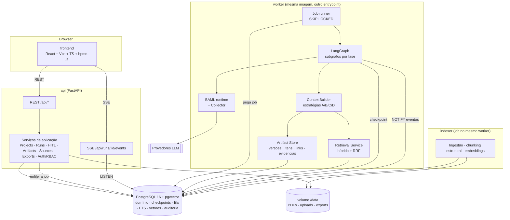
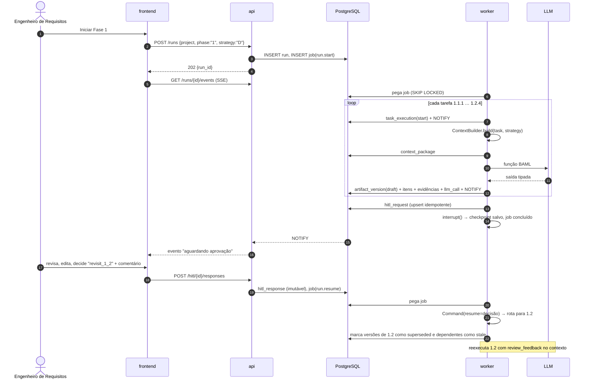

# 04 — Arquitetura de software [PROPOSTA]

## 4.1 Visão de componentes



### Responsabilidades

| Componente | Responsável por | Não faz |
|---|---|---|
| **frontend** | Navegação BPMN, acompanhamento, edição, aprovação, consenso, evidências, painéis | Nenhuma regra de processo |
| **api** | Autenticação, RBAC, CRUD, registro de respostas HITL, enfileiramento, SSE, exports | Não chama LLM; não executa o grafo |
| **worker** | Executa e retoma grafos, constrói contexto, chama BAML, grava artefatos e métricas, indexa corpus | Não atende HTTP |
| **PostgreSQL** | Fonte de verdade de tudo, inclusive fila e notificações | — |
| **volume** | Binários (PDFs, uploads, `.md`/`.docx`/`.pdf` gerados) | — |

## 4.2 Por que separar o worker da API mesmo no MVP

- Chamadas LLM duram de segundos a minutos. Uma fase inteira dura vários minutos.
- O `uvicorn --reload` e o reinício da API não podem matar execuções em andamento.
- Escalar a API (vários processos) não pode duplicar execuções.
- Com fila em PostgreSQL, a separação custa **um serviço a mais no compose, nenhuma
  tecnologia a mais**.

## 4.3 Fila em PostgreSQL

```sql
-- Retirada de job (cada worker, em laço)
UPDATE job SET status = 'running', locked_by = :worker, locked_at = now(), attempts = attempts + 1
WHERE id = (
  SELECT id FROM job
  WHERE status = 'queued' AND run_after <= now()
  ORDER BY priority DESC, created_at
  FOR UPDATE SKIP LOCKED
  LIMIT 1
)
RETURNING *;
```

| Tipo de job | Disparado por | O que faz |
|---|---|---|
| `run.start` | API (usuário inicia a fase) | `graph.ainvoke(input, config={thread_id})` até `interrupt` ou `END` |
| `run.resume` | API (decisão HITL registrada / consenso fechado) | `graph.ainvoke(Command(resume=payload), config)` |
| `corpus.index` | API (upload de fonte) | Ingestão, chunking e embeddings, de forma incremental por hash |
| `export.render` | API ou fim de fase | Gera `.md` (e `.docx`/`.pdf` via pandoc) de uma versão |
| `experiment.batch` | Pesquisador | Enfileira N execuções com configurações fixadas (cap. 09) |

**Robustez:**
- Se um job ficar com `locked_at` antigo (worker morreu), um *reaper* o devolve à fila.
- Uma execução só tem um job ativo por `thread_id`. Isso é garantido por um índice único
  parcial (`WHERE status IN ('queued','running')`).
- A alternativa de biblioteca é o `procrastinate`, que implementa exatamente esse padrão
  [PENDENTE-EQUIPE].

**Eventos em tempo real:** o worker grava em `run_event` e faz
`NOTIFY run_events, '<run_id>'`. A API mantém um `LISTEN` e repassa via SSE. Não há
Redis.

## 4.4 Estado do grafo × banco de domínio

Para evitar **duas fontes de verdade**:

| Onde | Contém | Não contém |
|---|---|---|
| Checkpoint LangGraph (`PostgresSaver`) | cursor de execução, `project_id`, `run_id`, mapa `artifact_type → artifact_version_id` atual, `pending_hitl_id`, contadores de iteração | conteúdo dos artefatos, trechos RAG |
| Tabelas de domínio | conteúdo, itens, versões, links, evidências, decisões, métricas | posição de execução |

```python
# [PROPOSTA] — formato do estado (ilustrativo, não implementado)
class RunState(TypedDict):
    project_id: str
    run_id: str
    manifest_version: str
    context_strategy: str             # "A" | "B" | "C" | "D"
    current: dict[str, str]           # artifact_type -> artifact_version_id
    pending_hitl_id: str | None
    iteration: dict[str, int]         # subprocesso -> nº de passagens (ex.: {"1.2": 2})
    review_feedback: list[str]        # IDs de hitl_response a considerar
```

O blackboard atual (`blackboard.json`) passa a ser uma **visão derivada**, que pode ser
exportada para depuração, mas não é mais persistido como fonte.

## 4.5 Fluxo de execução de uma fase com aprovação



## 4.6 Organização de diretórios proposta

A reorganização será feita **em PR futuro**, não nesta branch.

```
OpenUPExp-LangGraph/
├── docker-compose.yml
├── .env.example
├── docs/architecture/                 # este documento
├── process/
│   ├── manifest/openupexp-0.1.0.yaml  # manifesto versionado (cap. 02)
│   └── bpmn/                          # cópia fixada (ou submódulo) dos .bpmn de referência
├── templates/                         # templates de exportação (Jinja/Markdown) derivados da teoria
├── backend/
│   ├── pyproject.toml                 # versões fixadas (resolve P-12)
│   ├── baml_src/                      # FONTE ÚNICA dos contratos (+ generators.baml — P-11)
│   ├── baml_client/                   # gerado
│   ├── openupexp/
│   │   ├── api/                       # FastAPI: routers, schemas (gerados do BAML), auth
│   │   ├── domain/                    # entidades, serviços de aplicação, regras de versão/invalidação
│   │   ├── db/                        # SQLAlchemy, migrações Alembic
│   │   ├── queue/                     # job runner, reaper, LISTEN/NOTIFY
│   │   ├── process/                   # leitura e validação do manifesto ↔ BPMN
│   │   ├── agents/
│   │   │   ├── graphs/phase1_vision.py
│   │   │   ├── nodes/                 # um módulo por tarefa (chama BAML)
│   │   │   └── hitl/                  # ApprovalGate, ConsensusGate
│   │   ├── context/                   # ContextBuilder + estratégias A/B/C/D + coverage guard
│   │   ├── retrieval/                 # ingestão, chunkers estruturais, busca híbrida, verificação de citação
│   │   ├── exports/                   # renderização de templates, pandoc
│   │   └── observability/             # Collector BAML → llm_call, custos
│   ├── worker_main.py                 # entrypoint do worker
│   └── tests/
├── frontend/
│   ├── package.json
│   └── src/
│       ├── app/  pages/  components/
│       ├── bpmn/                      # viewer, overlays de status
│       ├── artifacts/                 # editores gerados por JSON Schema
│       └── api/                       # cliente gerado do OpenAPI
├── experiments/
│   ├── configs/                       # matrizes de configuração (estratégia × modelo × caso)
│   ├── cases/                         # escopos e corpora por domínio (INPI, …)
│   ├── gold/                          # gabaritos de referência
│   └── analysis/                      # notebooks/scripts de análise estatística
└── legacy/                            # main.py e workers atuais, preservados para comparação
```

O código atual (`main.py`, `worker*.baml`) deve ir para `legacy/` e permanecer executável.
Ele é a **linha de base** dos experimentos: equivale à estratégia "atual", próxima de A/C.

## 4.7 Docker Compose (esboço)

```yaml
# [PROPOSTA] — esboço, não implementado
services:
  db:
    image: pgvector/pgvector:pg16
    environment: [POSTGRES_DB=openupexp, POSTGRES_USER=openupexp, POSTGRES_PASSWORD=${DB_PASSWORD}]
    volumes: [pgdata:/var/lib/postgresql/data]
    healthcheck: { test: ["CMD", "pg_isready", "-U", "openupexp"], interval: 5s }

  api:
    build: ./backend
    command: uvicorn openupexp.api.main:app --host 0.0.0.0 --port 8000
    env_file: .env
    depends_on: { db: { condition: service_healthy } }
    volumes: [data:/data]
    ports: ["8000:8000"]

  worker:
    build: ./backend                   # mesma imagem
    command: python worker_main.py
    env_file: .env                     # chaves dos provedores LLM só aqui
    depends_on: { db: { condition: service_healthy } }
    volumes: [data:/data, hf_cache:/root/.cache/huggingface]

  frontend:
    build: ./frontend                  # dev: vite; prod: nginx servindo build estático
    ports: ["5173:80"]
    depends_on: [api]

volumes: { pgdata: {}, data: {}, hf_cache: {} }
```

Notas:
- **Migrações:** rodam como passo `alembic upgrade head` antes de subir a API, via
  serviço `migrate` *one-shot*.
- **Chaves dos provedores LLM:** ficam apenas no worker. A API não precisa delas.
- **Modelo de embedding:** é carregado no worker e cacheado em volume. Se o consumo de
  memória incomodar, pode virar um serviço próprio, por exemplo
  `text-embeddings-inference` [PENDENTE-EQUIPE].

## 4.8 API — principais recursos

| Método e rota | Uso |
|---|---|
| `POST /projects` · `GET /projects/:id` | Projeto (domínio, escopo, corpus, membros) |
| `POST /projects/:id/sources` | Upload de escopo ou fonte da Reference Base → `corpus.index` |
| `POST /projects/:id/runs` | Inicia fase com `{phase, context_strategy, model_profile}` |
| `GET /runs/:id` · `GET /runs/:id/events` (SSE) | Estado e eventos |
| `GET /runs/:id/tasks` | Execuções de tarefa (status para overlay BPMN) |
| `GET /artifacts/:type?project=` · `GET /artifact-versions/:id` | Artefatos, versões, itens |
| `GET /artifact-versions/:a/diff/:b` | Diff estruturado |
| `POST /artifact-versions/:id/edits` | Edição humana (gera nova versão `human_edit`) |
| `GET /hitl?assignee=me` · `POST /hitl/:id/responses` | Inbox e decisão/voto |
| `POST /hitl/:id/close` | Fechamento de consenso pelo Engenheiro |
| `GET /evidence/:id` · `GET /chunks/:id` | Evidência e trecho original |
| `POST /exports` | `.md`/`.docx`/`.pdf` de uma versão |
| `GET /metrics/runs/:id` | Tokens, custo, latência por tarefa |
| `GET /process/manifest` · `GET /process/bpmn/:file` | Manifesto e BPMN para o viewer |

Os schemas de request/response dos artefatos são **gerados dos tipos BAML** (cap. 08).
O cliente TypeScript do frontend é gerado do OpenAPI.
