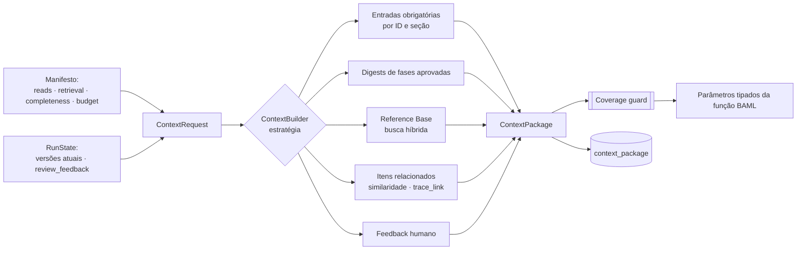
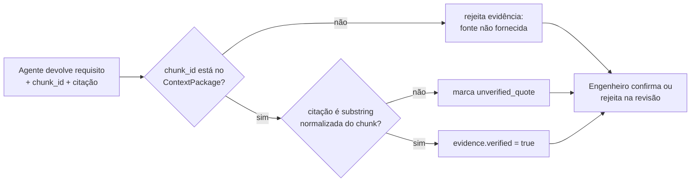

# 05 — Contexto e evidências

> **Em poucas palavras.** Este capítulo responde a duas perguntas. *O que cada agente recebe
> para ler?* — só o necessário para a sua tarefa, escolhido por uma de quatro estratégias (A, B,
> C, D), com verificação de que nada obrigatório ficou de fora. *Como saber se uma citação é
> verdadeira?* — leis e manuais são divididos por artigo e seção, a busca combina palavras e
> significado, e toda citação é conferida contra o texto original.
>
> **Situação:** estratégias A, C e D e a busca híbrida estão em uso desde a Etapa 1; a **B**
> (por semelhança) foi implementada no passo 4 do cap. 14 [IMPLEMENTADO].


## 5.1 Problema

[IMPLEMENTADO] Hoje cada worker recebe o que o código do nó decide passar. Às vezes é o
resultado do worker anterior, às vezes o Markdown inteiro (W5), às vezes todos os
artefatos da Visão (W6). Com o crescimento do ERD nas fases 2–4, isso leva a três
problemas:

- custo e latência crescentes;
- diluição da atenção do modelo;
- falta de registro de *o que exatamente* cada agente viu.

Sem esse registro, não é possível explicar uma saída, um requisito central da própria
teoria. Também não é possível reproduzir um experimento.

## 5.2 Conceito

O **ContextBuilder** é o único caminho por onde um agente recebe informação. Ele recebe
um **ContextRequest**, derivado do manifesto, e devolve um **ContextPackage** tipado,
persistido e com hash.



## 5.3 Contratos do ContextBuilder

```python
# [PROPOSTA] — ilustrativo
class ReadSpec(BaseModel):
    artifact: str                    # "vision.stakeholders"
    select: Literal["full", "all_items", "items", "section", "digest"]
    item_ids: list[str] | None = None
    section: str | None = None
    required: bool = True

class RetrievalSpec(BaseModel):
    store: Literal["reference_base", "elicitation_sources", "project_scope"]
    planner: str | None              # função BAML que gera consultas (ex.: PlanReferenceQueries)
    mode: Literal["hybrid", "lexical", "vector"] = "hybrid"
    top_k: int = 10
    filters: dict = {}

class ContextRequest(BaseModel):
    run_id: str
    task_id: str                     # "1.2.2"
    reads: list[ReadSpec]
    retrieval: list[RetrievalSpec] = []
    related: Literal["none", "similar_items", "trace_links"] = "none"
    completeness: Literal["none", "all_items", "all_pairs"] = "none"
    token_budget: int | None = None

class ContextItem(BaseModel):
    origin: Literal["required", "digest", "retrieved", "related", "feedback"]
    ref: str                         # "artifact_version:<uuid>#STK-02" | "chunk:<uuid>"
    content: str | dict
    reason: str                      # por que entrou (auditoria/explicação)

class CoverageReport(BaseModel):
    required_ids: list[str]
    included_ids: list[str]
    missing_ids: list[str]
    satisfied: bool

class ContextPackage(BaseModel):
    strategy: str                    # "D-hybrid@1.0"
    items: list[ContextItem]
    coverage: CoverageReport
    token_estimate: int
    sha256: str                      # hash canônico dos items → reprodutibilidade
```

## 5.4 Estratégias intercambiáveis

| Estratégia | Como monta o contexto | Coverage guard | Uso |
|---|---|---|---|
| **A — Contexto integral** | Renderiza o documento Markdown completo atual (como o W5 faz hoje) e o entrega inteiro | não se aplica (tudo entra) | Linha de base experimental |
| **B — Recuperação semântica** | Indexa os itens dos artefatos do projeto; recupera top-k por similaridade com a descrição da tarefa | **só mede, não corrige** | Experimental — mede a perda por top-k. [IMPLEMENTADO] (top-8; cap. 14 §14.5) |
| **C — Contratos estruturados** | Entrega exatamente os `reads` declarados no manifesto, sem RAG adicional sobre artefatos | aplicado | Experimental e produção simples |
| **D — Híbrida** (padrão) | C + digests das fases aprovadas + Reference Base híbrida + itens relacionados quando `related` ≠ none | **aplicado e obrigatório** | Produção |

Interface:

```python
class ContextStrategy(Protocol):
    name: str
    version: str
    async def build(self, req: ContextRequest, store: ArtifactStore,
                    retrieval: RetrievalService) -> ContextPackage: ...
```

A estratégia é escolhida **por execução** (`run.context_strategy`), não por worker.
Assim, o mesmo grafo e os mesmos prompts rodam sob estratégias diferentes, que é a
condição para um experimento controlado.

### Como uma estratégia alimenta uma função BAML tipada

As funções BAML propostas seguem um formato padronizado (cap. 08):

```
function IdentifyExplainabilityNeeds(
  entrada: IdentifyNeedsInput,     // campos tipados obrigatórios
  contexto: ContextItem[]          // material adicional, com origem e referência
) -> ExplainabilityNeedsArtifact
```

- **C/D:** preenchem `entrada` a partir dos `reads`; `contexto` recebe digest, evidências
  e relacionados.
- **A:** preenche `entrada` normalmente e coloca o documento inteiro em `contexto`.
- **B:** preenche `entrada` apenas com os itens recuperados por similaridade.

Os campos não recuperados ficam vazios e marcados. É assim que a perda se torna
mensurável.

## 5.5 Coverage guard

Nas tarefas com `completeness: all_items` (ex.: 3.2.1, 3.2.6, 4.2.1) ou
`completeness: all_pairs` (3.2.3, 3.2.4):

1. **Antes da chamada:** a lista canônica de IDs vem do banco, nunca do LLM. Se o
   contexto não contém todos, a estratégia C/D compacta (resumo de uma linha por item)
   em vez de omitir. Se ainda assim estourar o orçamento, a tarefa passa para o padrão
   map/reduce (cap. 03).
2. **Depois da chamada:** a saída é verificada. Todo ID de entrada precisa aparecer na
   saída. Os IDs faltantes geram uma nova chamada restrita a eles (no máximo N
   tentativas). Persistindo a falta, o `task_execution` falha com `coverage_error`
   visível na UI.
3. **Pares:** em `all_pairs` registra-se quais pares foram avaliados, seja por
   verificação explícita, seja por descarte por similaridade abaixo do limiar. A
   cobertura de pares vira métrica.

## 5.6 Digests

- Gerados em **1.3.2 / 2.3.2 / 3.3.2 / 4.3.2**, sempre a partir da versão aprovada.
- **Contexto auxiliar, nunca substituto:** os dados completos, as evidências e os links
  continuam disponíveis e são entregues sempre que um `read` os exige.
- Cada digest guarda a lista de IDs que cobre. Uma verificação determinística confere
  que todo `STK`, `NEED` e `CR` aprovado é mencionado por ID no digest.
- Por ser gerado por LLM, o digest é ele mesmo um artefato versionado com `llm_call`, e
  pode ser avaliado (perda de informação digest × completo é uma pergunta de pesquisa).

## 5.7 Retrieval Service

### Ingestão e chunking estrutural

| Tipo de fonte (`source_kind`) | Unidade de chunk | Metadados |
|---|---|---|
| `lei` | Artigo (com seus parágrafos, incisos e alíneas); artigos longos são subdivididos por parágrafo, mantendo o *caput* como prefixo | lei, número, artigo, parágrafo, página |
| `manual` | Seção/subseção por título numerado; janela com sobreposição dentro da seção | manual, seção, título, página |
| `academico` | Seção → parágrafos agrupados até o limite | título, seção, página |
| `escopo` | Seção do documento de escopo | seção |
| `elicitacao` | Turno ou bloco de transcrição, com o falante | stakeholder, data, sessão |

- Cada chunk tem um **ID estável e legível**, ex.:
  `lei_13709_lgpd:art20:par1`, `manual_marcas_exames:sec5.2.1:c0`.
- Cada chunk tem um `sha256` do texto. A reindexação é **incremental**: só reprocessa
  documentos cujo hash mudou (resolve P-08).
- Cada indexação gera um `corpus_version`. Toda execução registra qual versão usou.
- **[PENDENTE-EQUIPE]:** os manuais do INPI têm 6 MB e podem ter páginas digitalizadas.
  É preciso verificar a qualidade da extração com `pypdf` e avaliar alternativas
  (`pymupdf`, OCR) antes de fixar o chunker.

### Embeddings [PENDENTE-EQUIPE]

| Modelo | Dimensão | Contexto máx. | Observação |
|---|---|---|---|
| `paraphrase-multilingual-MiniLM-L12-v2` (atual) | 384 | **128 tokens** | Trunca os chunks atuais (P-05) |
| `BAAI/bge-m3` | 1024 | 8192 | Multilíngue; gera também vetor esparso; mais pesado |
| `intfloat/multilingual-e5-base` | 768 | 512 | Bom equilíbrio; exige os prefixos `query:` e `passage:` |

O modelo e a sua versão são registrados em `corpus_version`. Trocar o modelo gera um
novo `corpus_version`, sem sobrescrever o anterior. Isso permite comparar experimentos.

### Busca híbrida

```sql
-- [PROPOSTA] — RRF entre lexical (português) e vetorial
WITH lex AS (
  SELECT id, row_number() OVER (ORDER BY ts_rank_cd(tsv, q) DESC) AS r
  FROM chunk, websearch_to_tsquery('portuguese', :query) q
  WHERE tsv @@ q AND corpus_version_id = :cv AND source_kind = ANY(:kinds)
  ORDER BY r LIMIT 50
), vec AS (
  SELECT id, row_number() OVER (ORDER BY embedding <=> :qvec) AS r
  FROM chunk
  WHERE corpus_version_id = :cv AND source_kind = ANY(:kinds)
  ORDER BY embedding <=> :qvec LIMIT 50
)
SELECT id, SUM(1.0 / (60 + r)) AS score
FROM (SELECT * FROM lex UNION ALL SELECT * FROM vec) u
GROUP BY id ORDER BY score DESC LIMIT :k;
```

- **Referências explícitas:** padrões como "Art. 20", "§ 1º" e "Lei 13.709" são
  detectados na consulta e aplicados como filtro de metadado antes do ranking. Isso é
  exato e não depende do embedding.
- **Planejamento de consultas:** o W5 atual gera **uma** consulta longa. A proposta é
  que o `PlanReferenceQueries` gere **várias consultas curtas**, uma por subseção 5.1–5.5
  e por necessidade, cada uma com o filtro `source_kind` adequado. Os resultados são
  fundidos e deduplicados.

## 5.8 Gestão de evidências

### Tipos de evidência

Os tipos seguem a regra 12 do prompt do W6 [IMPLEMENTADO no prompt, ausente no tipo]:

| `evidence.kind` | Significado |
|---|---|
| `obrigacao_normativa` | O trecho estabelece uma obrigação legal ou normativa aplicável ao contexto |
| `recomendacao_tecnica` | O trecho recomenda, mas não obriga (literatura, manual de boas práticas) |
| `derivado_visao` | O requisito decorre de uma necessidade da Visão; o trecho apenas contextualiza |

### Ciclo de vida da evidência



- **Verificação mecânica (DET):** a citação precisa ser um trecho literal do chunk
  (comparação normalizada: espaços, hífens de quebra de linha, caixa). Isso detecta
  citações inventadas sem gastar LLM.
- **Política de aceitação:**
  - requisito com `evidence: required` no manifesto e **sem** evidência verificada →
    entra como `draft` com o alerta "sem fundamentação" e não pode ser aprovado sem
    justificativa humana explícita;
  - evidência `unverified_quote` → aparece destacada na UI.
- **Evidência pertence ao corpus:** a evidência aponta para `chunk_id` +
  `corpus_version`. Ao reindexar o corpus, as evidências antigas continuam válidas para
  a versão antiga. Uma reexecução produz evidências novas. Isso resolve P-04: os trechos
  saem do blackboard.
