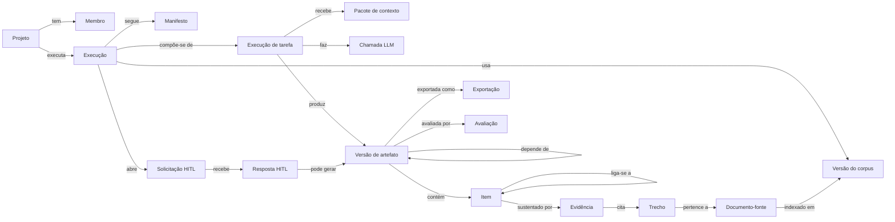
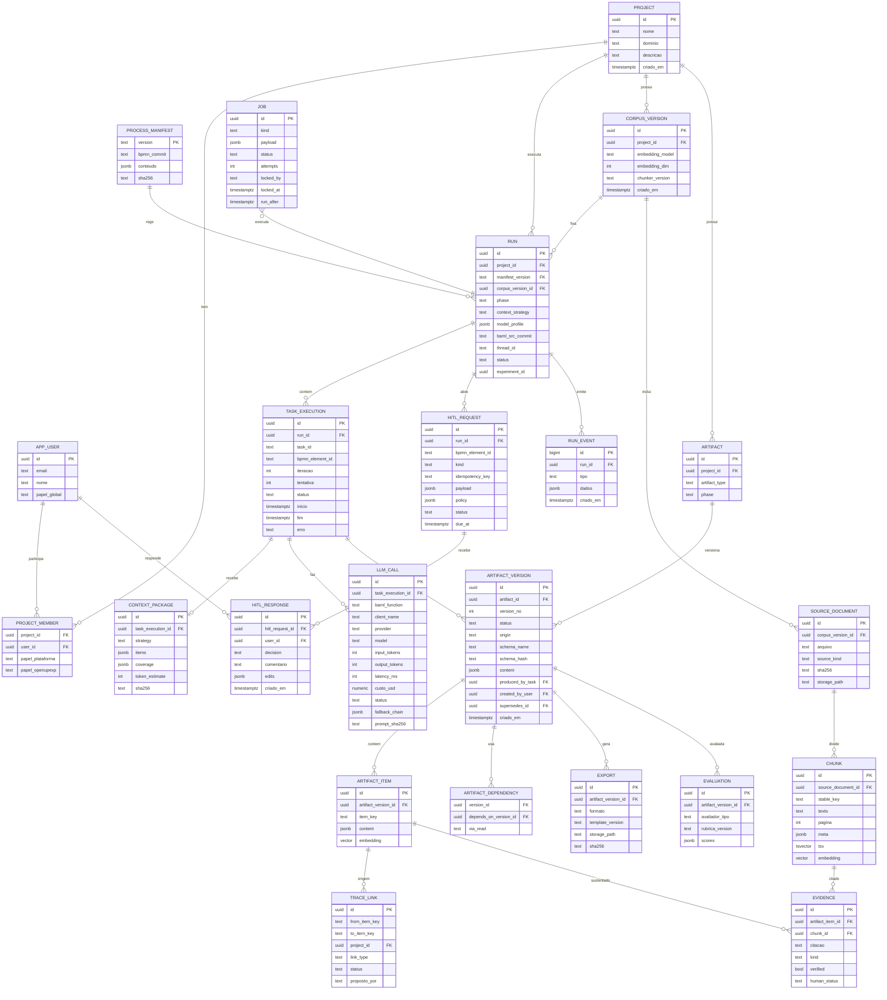
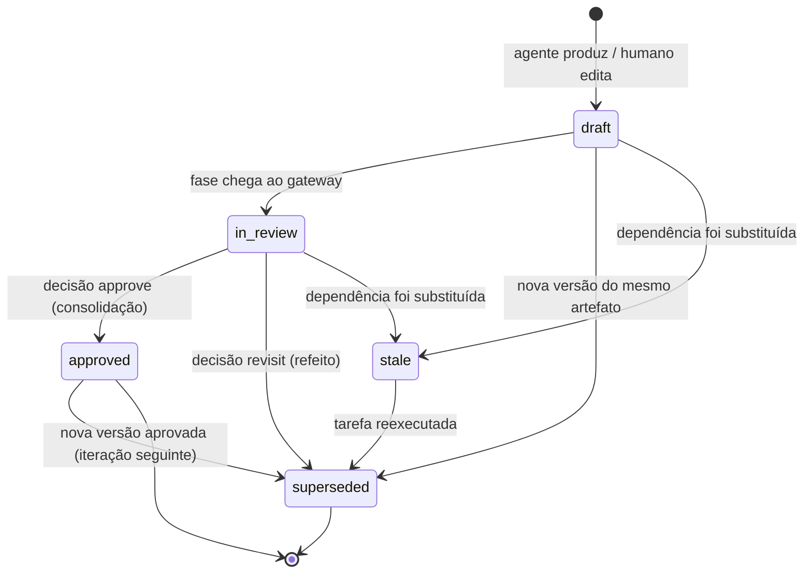

# 06 — Modelo de dados

> **Em poucas palavras.** Tudo o que a plataforma produz fica guardado de forma estruturada e
> com histórico: cada artefato tem versões (rascunho, em revisão, aprovada, substituída,
> desatualizada), cada item tem um identificador estável (STK-01, REQ-03…), e cada decisão
> humana fica registrada. Nada é sobrescrito.

### Tabelas acrescentadas depois do desenho original [IMPLEMENTADO]

| Tabela | O que guarda | Capítulo |
|---|---|---|
| `llm_model`, `inference_profile` | Modelos de IA cadastrados e seus perfis de uso (temperatura, limites), com o resultado do teste de compatibilidade | 14 |
| `lab_comparison`, `lab_trial`, `lab_rating` | Comparações do laboratório, cada tentativa (modelo, estratégia, repetição, métricas) e as notas humanas | 14 |
| `lab_gold` | Gabaritos por projeto e tarefa | 14 |
| `corpus_version.purpose` / `run_id` | Separa a base de consulta do material das entrevistas de cada execução | 13 |

Além disso, `run.model_profile` passou a guardar a **configuração completa do modelo** usada na
execução (inclusive a versão dos pesos do modelo local).


## 6.1 Modelo conceitual



## 6.2 Modelo lógico (ER)



Tabelas complementares, fora do diagrama por legibilidade:

- `audit_event` (append-only: ator, ação, entidade, hash antes/depois);
- `experiment` (configuração da matriz e semente);
- `gold_item` (gabaritos — cap. 09);
- os checkpoints do LangGraph, criados pelo `PostgresSaver.setup()`.

## 6.3 Decisões do modelo

| Decisão | Motivo |
|---|---|
| **`ARTIFACT_VERSION.content` em JSONB, validado pelo schema BAML** (`schema_name` + `schema_hash`) | Artefatos mudam de forma quando a teoria muda; JSONB evita uma migração por campo, e o hash do schema garante que se saiba com qual contrato a versão foi produzida |
| **`ARTIFACT_ITEM` com `item_key` estável** (`STK-02`, `REQ-014`) | Os IDs sobrevivem entre versões: o `REQ-014` da v3 é o mesmo requisito do `REQ-014` da v1. Diffs, rastreabilidade e "correções humanas" são medidas por item |
| **`TRACE_LINK` por `item_key`, não por versão** | Rastreabilidade é uma relação entre conceitos; o status do link (`proposed`/`accepted`/`rejected`) é versionado à parte |
| **`ARTIFACT_DEPENDENCY` registrado a partir do `ContextPackage`** | A dependência real é "o que o agente viu", não apenas o que o manifesto declarou |
| **`origin` da versão:** `agent`, `human_edit`, `consensus`, `consolidation`, `import` | Permite medir quanto do artefato final é humano × IA |
| **`HITL_RESPONSE` imutável** | Auditoria de decisões; um novo voto é uma nova linha |
| **Vetores em `CHUNK` e `ARTIFACT_ITEM`** | Reference Base e similaridade entre requisitos (cap. 03) |

Índices principais:
- `HNSW (embedding vector_cosine_ops)` em `chunk` e `artifact_item`;
- `GIN (tsv)` em `chunk`;
- `UNIQUE (artifact_id, version_no)`;
- `UNIQUE (hitl_request.idempotency_key)`;
- índice único parcial em `job (payload->>'run_id') WHERE status IN ('queued','running')`.

## 6.4 Ciclo de vida das versões de artefato



Regras:
- Existe no máximo **uma** versão `approved` vigente por artefato.
- Nenhuma versão é apagada.
- `approved` só é atingido via `HITL_RESPONSE` do papel autorizado (cap. 07).
- Uma versão `stale` não pode ser aprovada; a UI bloqueia a aprovação até a reexecução.

## 6.5 Invalidação automática

Quando a versão `v` é substituída, todas as versões que dependem dela (transitivamente)
e que ainda não estão `approved`/`superseded` passam a `stale`:

```sql
-- [PROPOSTA]
WITH RECURSIVE dependentes AS (
  SELECT d.version_id
  FROM artifact_dependency d
  WHERE d.depends_on_version_id = :versao_substituida
  UNION
  SELECT d.version_id
  FROM artifact_dependency d
  JOIN dependentes x ON d.depends_on_version_id = x.version_id
)
UPDATE artifact_version av
SET status = 'stale'
FROM dependentes x
WHERE av.id = x.version_id AND av.status IN ('draft', 'in_review')
RETURNING av.id;
```

**Versões aprovadas de fases anteriores:** uma mudança na Fase 2 não invalida a Visão
aprovada. O contrário, sim: se a Visão for reaberta, tudo da Fase 2 em diante fica
`stale`. Reabrir uma fase já aprovada é uma ação explícita e auditada do Engenheiro.

**[PENDENTE-AUTORA]:** a teoria permite reabrir uma fase aprovada? O BPMN só prevê
retorno dentro da mesma macroatividade, e `Fase Concepção.md` diz que o DRE "é
continuamente atualizado a cada iteração".

## 6.6 Auditoria

Toda mutação de domínio grava `audit_event(actor_type, actor_id, action, entity,
entity_id, before_sha, after_sha, at)`:
- `actor_type`: `user`, `agent` ou `system`;
- `action`: por exemplo `approve`, `edit`, `index_corpus`.

Junto com `llm_call`, `context_package` e `hitl_response`, isso permite responder a
perguntas como:
- quem decidiu, quando e com base em quê;
- o que o agente viu;
- qual modelo foi usado e quanto custou.
