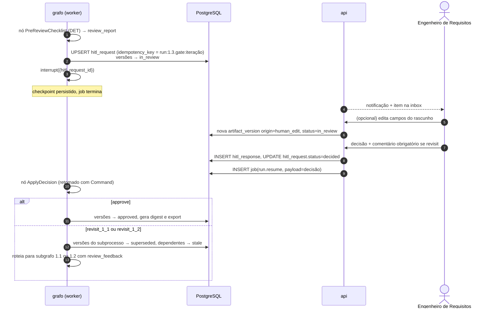
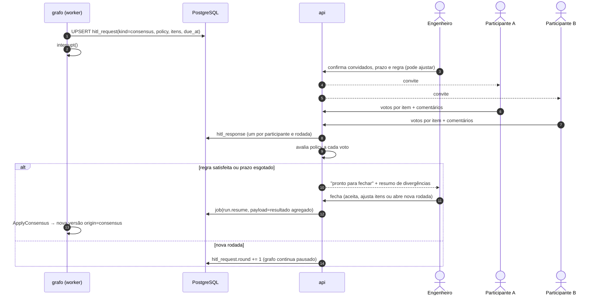

# 07 — Pessoas no processo: aprovação e consenso

> **Em poucas palavras.** O BPMN prevê dois tipos de participação humana, e a plataforma os
> trata de forma diferente. A **aprovação** é individual: o Engenheiro de Requisitos aprova ou
> pede para a IA refazer uma parte, com um comentário que orienta a nova tentativa. O
> **consenso** é coletivo: cada participante diz se concorda, concorda com observações ou
> discorda, e o Engenheiro encerra a rodada ou pede ajustes.
>
> **Situação:** os dois mecanismos funcionam nas quatro etapas [IMPLEMENTADO]. A regra de
> fechamento do consenso é provisória e aguarda a autora (A-13, cap. 12).


## 7.1 Dois mecanismos distintos

| | **Aprovação individual** | **Consenso assíncrono** |
|---|---|---|
| Origem na teoria [TEORIA] | Gateways `… approved?` (1.3, 2.3, 3.3, 4.3) | Tarefas `Reach Consensus` (2.2.5, 3.2, 4.2.5) e passo "Obter consenso" de todas as tarefas textuais |
| Quem decide | Um papel: **Engenheiro de Requisitos** (lane única do BPMN) | Vários participantes (stakeholders e especialistas) — **[PENDENTE-AUTORA] I-08** |
| Resultado | `approve` · `revisit_X_1` · `revisit_X_2` + comentário (+ edições) | Por item: `concordo` · `concordo com ressalvas` · `discordo` + comentário; fechamento pela regra |
| Duração típica | Minutos a horas | Dias |
| Retomada do grafo | Uma vez, com a decisão | Uma vez, quando o consenso **fecha** — os votos individuais não retomam o grafo |
| Mecanismo LangGraph [PROPOSTA] | `ApprovalGate`: `interrupt()` → `Command(resume=decisão)` | `ConsensusGate`: `interrupt()` → `Command(resume=resultado_agregado)` |

## 7.2 Papéis na plataforma [PROPOSTA]

Os papéis da teoria (`papeis/`) [TEORIA] são mapeados para permissões da plataforma:

| Papel da plataforma | Pode | Papéis OpenUPExp associados |
|---|---|---|
| `admin` | Gerir usuários, projetos, corpora | — |
| `requirements_engineer` | Iniciar fases, editar artefatos, **decidir gateways**, abrir e fechar consensos, reabrir fase | Engenheiro de Requisitos |
| `participant` | Ver artefatos do projeto, votar e comentar em consensos para os quais foi convidado | Stakeholders, Especialista de Domínio, Especialista em IA, Especialista em Regulação, Arquiteto, Gerente de Projeto |
| `observer` | Somente leitura (orientador, auditor) | — |
| `researcher` | Configurar experimentos, ver métricas e execuções de todos os projetos experimentais | — |

`project_member.papel_openupexp` registra o papel teórico (ex.: "Especialista em
Regulação"), para que relatórios e consensos usem o vocabulário da teoria.
Autenticação [PENDENTE-EQUIPE]: contas locais com JWT no MVP; OIDC (ex.: Keycloak) se a
instituição exigir.

## 7.3 Fluxo de aprovação (gateway)



### Idempotência

Ao retomar, o LangGraph **reexecuta o nó que chamou `interrupt()` desde o início**.
Regras de projeto:

1. O nó que chama `interrupt()` (`ApprovalGate`) **não tem efeitos colaterais antes do
   `interrupt()`**, além de um `UPSERT` idempotente (`ON CONFLICT (idempotency_key) DO
   NOTHING`).
2. A aplicação da decisão fica num **nó separado** (`ApplyDecision`), que executa uma
   única vez por retomada.
3. Notificações por e-mail ou na UI saem da API a partir do `hitl_request`, não do grafo.
   Assim não se duplicam.
4. A `idempotency_key` inclui o número da iteração do subprocesso. Uma segunda passagem
   por 1.3, depois de um *revisit*, gera uma nova solicitação legítima.

### Edições humanas antes da decisão

- O Engenheiro pode corrigir campos do rascunho diretamente.
- Cada edição gera uma nova `artifact_version` com `origin=human_edit`.
- Com `approve`, a versão aprovada é a editada.
- Com `revisit`, as edições entram no `review_feedback` como exemplos do que o
  Engenheiro espera.
- A distância entre a versão do agente e a versão aprovada é a métrica **"correções
  humanas"** (cap. 09).

### Granularidade da revisão [PROPOSTA]

- Comentários podem ser feitos **por seção e por item**, por exemplo "STK-03 está
  errado: não é stakeholder".
- A decisão final continua sendo a do gateway (subprocesso), como no BPMN.
- Os comentários por item direcionam o `review_feedback` aos workers relevantes.

## 7.4 Fluxo de consenso



### Política de consenso (`hitl_request.policy`) [PROPOSTA]

```json
{
  "participants": ["user:…", "role:especialista_regulacao"],
  "rule": "all_agree | majority | no_blocking_objection | engineer_decides",
  "quorum": 0.6,
  "due_at": "2026-11-05T18:00:00-03:00",
  "on_timeout": "engineer_decides",
  "max_rounds": 3,
  "item_scope": ["REQ-001", "REQ-002", "…"]
}
```

O padrão proposto é `no_blocking_objection` + `engineer_decides` no timeout. A teoria não
define a regra [PENDENTE-AUTORA].

### Apoio da IA ao consenso [PROPOSTA]

- Um agente opcional `SummarizeDivergences` agrupa os comentários discordantes por item e
  propõe redações conciliadoras.
- **Quem decide são os humanos.** As propostas da IA aparecem identificadas como tal e
  precisam ser aceitas explicitamente.

### Fase 1 e consenso

- O BPMN da Fase 1 **não tem** tarefa "Reach Consensus".
- Os passos textuais 2 e 7 de `definir-visao.md` falam em "Adquirir consenso" e "Obter
  consenso (revisão da Visão)".
- Proposta: na Fase 1, o gateway 1.3 pode ser **precedido opcionalmente** de um
  consenso, configurável por projeto. O padrão é desligado, para seguir o BPMN.
  [PENDENTE-AUTORA]

## 7.5 Reabertura e iterações

- **`revisit` dentro da macroatividade:** previsto pela teoria (anotação dos gateways).
- **Reabrir uma macroatividade já aprovada** (por exemplo, voltar à Visão durante a
  Análise): ação explícita do Engenheiro, com justificativa obrigatória. Gera
  invalidação em cascata (cap. 06 §6.5). Não está prevista no BPMN [PENDENTE-AUTORA].
- **Limite de iterações:** cada subprocesso tem um contador (`RunState.iteration`).
  Acima de um limite configurável (padrão 5), a UI alerta. Não há bloqueio, porque a
  decisão é humana.
