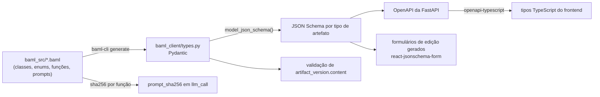

# 08 — Contratos dos agentes (BAML)

> **Em poucas palavras.** Cada agente de IA tem um "contrato": o que recebe, o que deve
> devolver e em que formato, além das regras de não invenção. Esses contratos são escritos em
> BAML, e a plataforma recusa respostas fora do formato. Os mesmos contratos valem para
> qualquer modelo de IA, o que permite compará-los de forma justa.
>
> **Situação:** contratos das quatro etapas implementados em `backend/baml_src/`. A escolha do
> modelo em tempo de execução, prevista em §8.5, é feita pelo catálogo do cap. 14.


## 8.1 Princípio: BAML como fonte única [PROPOSTA]



- **Nenhum modelo Pydantic de artefato é escrito à mão.** A API só declara *wrappers*
  (paginação, metadados de versão) em torno dos tipos gerados.
- **`generators.baml` passa a existir e fixa a versão** (resolve P-11):

```baml
// [PROPOSTA]
generator target {
  output_type "python/pydantic"
  output_dir "../"
  version "0.226.2"
  default_client_mode "async"
}
```

- **`schema_hash`:** cada `artifact_version` registra `schema_name` (nome da classe BAML)
  e `schema_hash` (hash do JSON Schema). Versões produzidas sob contratos antigos
  continuam legíveis, e a UI avisa quando o schema mudou.

## 8.2 Tipos comuns propostos [PROPOSTA]

```baml
// --- Lacunas explícitas em vez de texto livre "Requer investigação" ---
class Lacuna {
  campo string        @description("Nome do campo que não pôde ser preenchido")
  motivo string       @description("Por que a informação não está nas entradas")
  pergunta_sugerida string? @description("Pergunta que o Engenheiro pode fazer aos stakeholders")
}

// --- Material de contexto entregue pelo ContextBuilder ---
class ContextItem {
  origem string       @description("required | digest | retrieved | related | feedback")
  ref string          @description("Referência estável: artifact_version:<id>#STK-02 ou chunk:<stable_key>")
  conteudo string
}

// --- Referência a evidência na Reference Base ---
enum EvidenceKind {
  OBRIGACAO_NORMATIVA
  RECOMENDACAO_TECNICA
  DERIVADO_VISAO
}

class EvidenceRef {
  chunk_ref string    @description("Exatamente um ref de ContextItem com origem 'retrieved'")
  citacao string      @description("Trecho LITERAL copiado do chunk que sustenta a afirmação")
  tipo EvidenceKind
}

// --- Rastreabilidade ---
class OrigemRef {
  ref string          @description("ID de item de entrada, ex.: STK-02, NEED-01, ou trecho do escopo")
  relacao string      @description("Como a saída decorre desta entrada")
}
```

`Lacuna` substitui as frases fixas "Não identificado nas informações fornecidas…"
[IMPLEMENTADO nos prompts W1–W4]. O conteúdo semântico é o mesmo, mas fica estruturado
para que a UI destaque as lacunas e as transforme em perguntas para a elicitação.

## 8.3 Contratos da Fase 1 [PROPOSTA]

Os contratos atuais [IMPLEMENTADO] são preservados em `legacy/` como linha de base. Os
novos contratos **estendem** os atuais: os campos atuais são mantidos, e são acrescentados
IDs, origem, evidência e lacunas.

```baml
// 1.1.1 — evolução de ExplainabilityScope (W1)
class ProblemStatement {          // template §2.1
  o_problema_da string
  afeta string[]
  cujo_impacto_e string[]
  solucao_bem_sucedida string
}
class ExplainabilityProblem {
  necessidade_de_explicabilidade string
  descricao_geral string
  dominio_do_problema string
  stakeholders_mencionados string[]   // nomes literais do escopo; IDs são atribuídos em 1.1.2
  impactos string[]
  criterios_de_sucesso string?
  declaracao_problema ProblemStatement
  lacunas Lacuna[]
}

// 1.1.2 — Stakeholders (absorve W3)
class Stakeholder {
  id string                 @description("STK-n; preservar IDs existentes em revisões")
  nome string
  descricao string
  responsabilidade string?
  ambiente_usuario string?  // template §3.2
  origem OrigemRef[]
  lacunas Lacuna[]
}
class StakeholdersArtifact { stakeholders Stakeholder[] }

// 1.1.3 — Solicitações dos stakeholders
class StakeholderNeed {
  id string                 @description("SN-n")
  stakeholder_id string
  solicitacao string        @description("Nas palavras da fonte, sem reinterpretação")
  origem OrigemRef[]
}
class StakeholderNeedsArtifact { solicitacoes StakeholderNeed[] }

// 1.1.4 / 1.1.5 — Termos e glossário
class GlossaryTerm {
  id string                 @description("TERM-n")
  termo string
  definicao string
  sinonimos string[]
  origem OrigemRef[]
}
class GlossaryArtifact { termos GlossaryTerm[] }

// 1.2.1 — evolução de ExplainabilityFeatureNeed (W4)
class ExplainabilityNeed {
  id string                 @description("NEED-n")
  necessidade string
  stakeholder_ids string[]
  prioridade string?        // nulo = lacuna; não inventar
  planned_release string?
  aspecto_associado string? // [PENDENTE-AUTORA] I-10 — opcional até decisão
  origem OrigemRef[]
  lacunas Lacuna[]
}
class ExplainabilityNeedsArtifact { necessidades ExplainabilityNeed[] }

// Posicionamento — evolução de ExplainabilityPositioning (W2)
class Positioning {
  id string                 @description("POS-n")
  stakeholder_id string
  para_quem string
  para_que string
  nome_produto string?
  categoria_produto string?
  beneficio_chave string?
  unlike string?
  our_product string?
  lacunas Lacuna[]
}
class PositioningArtifact { posicionamentos Positioning[] }

// 1.2.2 — evolução de AdditionalExplainabilityRequirement (W6) — resolve P-03
enum ComplementaryCategory {
  NORMAS_REGULAMENTOS        // §5.1
  PLATAFORMA_DESEMPENHO      // §5.2
  QUALIDADE_EXPLICACOES      // §5.3
  RESTRICOES_DEPENDENCIAS    // §5.4
  DOCUMENTACAO_SUPORTE       // §5.5
}
class ComplementaryRequirement {
  id string                 @description("CR-n")
  categoria ComplementaryCategory
  requisito string
  justificativa string
  need_ids string[]         @description("Necessidades da Visão relacionadas — obrigatório")
  evidencias EvidenceRef[]  @description("Pelo menos uma; sem evidência, não produza o requisito")
}
class ComplementaryRequirementsArtifact { requisitos ComplementaryRequirement[] }

// 1.2.2 — evolução de W5: várias consultas focadas
class ReferenceQuery {
  secao ComplementaryCategory
  consulta string
  tipos_fonte string[]      // lei | manual | academico
  referencias_explicitas string[]  // ex.: "Lei 13.709 art. 20" — vira filtro de metadado
}
class ReferenceQueryPlan { consultas ReferenceQuery[] }

// 1.2.3 — Limites (checklist do DRE)
class LimitAnswer {
  dimensao string           @description("escopo | stakeholders | tipo_forma | momento | entradas_saidas | restricoes | rastreabilidade")
  pergunta string           @description("Pergunta do checklist, literal")
  resposta string?
  baseada_em OrigemRef[]
  lacuna Lacuna?
}
class ExplainabilityLimitsArtifact { respostas LimitAnswer[] }
```

### Assinaturas padronizadas

```baml
function IdentifyStakeholders(
  entrada: IdentifyStakeholdersInput,   // problema + escopo + stakeholders existentes (em revisão)
  contexto: ContextItem[]               // digest, feedback humano, etc.
) -> StakeholdersArtifact {
  client OpenUPExpDefault
  prompt #"
    {{ _.role("system") }}
    … regras de não invenção (preservadas dos prompts atuais) …
    Preserve os IDs STK-n já existentes em entrada.stakeholders_existentes.
    Considere o feedback do revisor em contexto (origem = feedback).
    {{ ctx.output_format }}
  "#
}
```

Toda função recebe `entrada` (tipada, obrigatória) e `contexto` (lista de
`ContextItem`). Isso permite trocar a estratégia de contexto sem mudar a assinatura
(cap. 05 §5.4).

## 8.4 Preservação de IDs em revisões

Quando um subprocesso é refeito, o worker recebe os itens existentes com seus IDs e deve
preservá-los. A atribuição final de IDs é **determinística**, não depende do LLM:

1. Um item devolvido com ID existente é atualizado.
2. Um item sem ID é casado por similaridade alta (≥ limiar) com um item existente, ou
   recebe o próximo ID livre.
3. Um item existente que não voltou só é removido se o feedback humano pediu a remoção;
   caso contrário, gera alerta de *coverage*.

## 8.5 Clientes LLM [PENDENTE-EQUIPE]

- **Perfis nomeados por papel**, por exemplo `OpenUPExpDefault`, `OpenUPExpCheap`
  (digests, consultas) e `OpenUPExpJudge` (avaliação), em vez de nomes de modelo como
  `GroqLlama70B`.
- **Fallback com modelos realmente diferentes** (resolve P-09). Cada execução registra a
  cadeia efetiva em `llm_call.fallback_chain`.
- **Experimentos:** o fallback **fica desligado**. Uma troca silenciosa de modelo
  invalida a comparação. O cliente é sobrescrito em tempo de execução (`ClientRegistry`
  do BAML) a partir de `run.model_profile`.
- **Temperatura fixa e registrada.** Sementes quando o provedor suportar.

## 8.6 Independência de domínio

- Prompts e contratos **não mencionam** INPI, marcas, LPI, financiamento ou qualquer
  domínio concreto. O domínio chega pelo escopo e pelo corpus.
- Um teste automatizado faz *lint* de `baml_src/` contra uma lista de termos de domínio
  conhecidos dos estudos de caso.
- Os `test` blocks do BAML usam fixtures **de pelo menos dois domínios**. O W1 atual já
  tem um caso de crédito imobiliário; deve ser mantido, junto com o caso INPI.

## 8.7 Testes de contrato

| Teste | Ferramenta | O que garante |
|---|---|---|
| `test` blocks por função | `baml-cli test` | O prompt continua produzindo o tipo esperado com fixtures fixas |
| Asserções de não invenção | `@@assert` / `@@check` do BAML, ou pós-validação Python | Por exemplo: todo `CR` tem `evidencias` não vazio; todo `need_ids` existe na entrada |
| Snapshot de JSON Schema | pytest | Mudanças de contrato são deliberadas e revisadas em PR |
| Compatibilidade de versão | pytest | Versões antigas de `artifact_version.content` continuam válidas ou têm migração |
