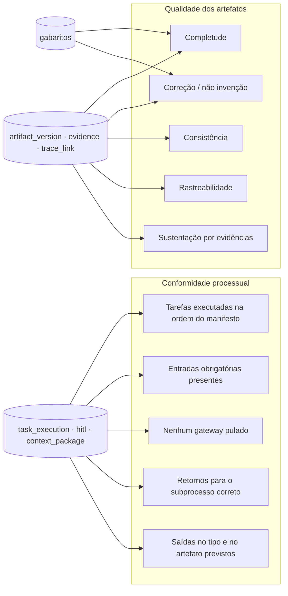

# 09 — Observabilidade e metodologia experimental [PROPOSTA]

## 9.1 Observabilidade operacional

### Coleta com BAML

O BAML oferece um `Collector` que registra uso de tokens, tempos e as chamadas HTTP
efetivas, inclusive qual cliente foi usado numa cadeia de fallback. O padrão proposto,
ilustrativo (conferir a API exata na versão fixada do `baml-py`):

```python
from baml_py import Collector

collector = Collector(name=f"{run_id}:{task_id}")
result = await b.IdentifyStakeholders(entrada, contexto,
                                      baml_options={"collector": collector})
log = collector.last
record_llm_call(
    task_execution_id=te.id,
    baml_function="IdentifyStakeholders",
    input_tokens=log.usage.input_tokens,
    output_tokens=log.usage.output_tokens,
    latency_ms=log.timing.duration_ms,
    calls=[(c.client_name, c.provider, c.selected) for c in log.calls],
    prompt_sha256=PROMPT_HASHES["IdentifyStakeholders"],
)
```

### O que é persistido

| Tabela | Campos | Uso |
|---|---|---|
| `llm_call` | função, cliente, provedor, modelo, tokens entrada/saída, latência, custo, status, cadeia de fallback, hash do prompt | Custo, desempenho, reprodutibilidade |
| `context_package` | estratégia, itens, cobertura, tokens estimados, hash | O que o agente viu |
| `task_execution` | tarefa, iteração, tentativa, tempos, erro | Conformidade processual, gargalos |
| `run_event` | eventos de execução | UI em tempo real e linha do tempo |
| `hitl_response` | decisões, comentários, edições | Esforço humano, qualidade percebida |
| `evaluation` | escores por rubrica | Qualidade dos artefatos |

**Custo:** uma tabela `model_price` (provedor, modelo, preço por 1M tokens de entrada e
de saída, vigência) permite recalcular o custo retroativamente.

**Ferramenta externa (opcional):** exportação OpenTelemetry para Arize Phoenix, se a
equipe quiser uma UI de *traces*. Langfuse v3 não é recomendado neste momento: exige
ClickHouse, Redis e armazenamento S3.

## 9.2 Duas dimensões de avaliação separadas



- **Conformidade processual** é verificável de forma **determinística** a partir dos
  logs de execução, comparados com o manifesto. Opcionalmente, pode-se usar *conformance
  checking* de mineração de processos (por exemplo, *token replay* com `pm4py`),
  exportando `task_execution` como log de eventos XES contra o BPMN de referência.
- **Qualidade dos artefatos** exige gabarito e avaliação humana e/ou LLM-juiz calibrado.
- Um sistema pode ter conformidade total e qualidade baixa. Os dois resultados são
  reportados separadamente.

## 9.3 Questões de pesquisa (proposta inicial)

| ID | Questão |
|---|---|
| QP1 | Como a estratégia de construção de contexto (A/B/C/D) afeta completude, correção, consistência e rastreabilidade dos artefatos de explicabilidade? |
| QP2 | Qual o custo (tokens, latência) de cada estratégia, e como ele escala ao longo das fases? |
| QP3 | Quanto se perde ao usar digests de fases aprovadas em vez dos dados completos? |
| QP4 | Como erros de agentes iniciais se propagam aos artefatos posteriores, e o HITL os contém? |
| QP5 | Quanto esforço humano (correções, iterações) cada estratégia exige até a aprovação? |
| QP6 | Os agentes respeitam o processo OpenUPExp (conformidade) independentemente da qualidade? |
| QP7 | A verificação mecânica de evidências reduz afirmações normativas sem fundamento? |

## 9.4 Desenho experimental

### Fatores e níveis

| Fator | Níveis |
|---|---|
| Estratégia de contexto | A (integral), B (semântica), C (contratos), D (híbrida) |
| Modelo LLM | 2–3 perfis fixos (ex.: um grande, um pequeno) [PENDENTE-EQUIPE] |
| Estudo de caso (domínio) | INPI/marcas + ≥ 2 outros domínios |
| Ordem dos workers da Visão | atual (W2→W3→W4) × BPMN (stakeholders→necessidades→posicionamento) — QP específica da Fase 1 |
| Digest | com × sem (QP3) |

**Delineamento:** fatorial parcial. Cada configuração é executada **≥ 5 vezes** com
temperatura fixa, para estimar a variância intrínseca do LLM. Execuções experimentais
**não usam fallback**. Cada execução fixa: manifesto, commit do `baml_src`, modelo,
`corpus_version`, estratégia e semente.

### Estudos de caso

| Caso | Situação | Observação |
|---|---|---|
| INPI — registro de marcas | Escopo e corpus existentes neste repositório | Estudo de caso inicial |
| Crédito imobiliário | Fixture do W1 (`worker1.baml`, teste) — escopo curto | Precisa de escopo completo e corpus |
| Terceiro domínio (ex.: saúde) | A definir [PENDENTE-EQUIPE] | Deve ter regulação diferente para testar a generalização |

**Importante:** como medido no cap. 01, o contexto da Fase 1 do caso INPI é pequeno
(≈ 17 KB). **Espera-se pouca diferença entre estratégias na Fase 1.** As diferenças devem
aparecer nas fases 2–4 ou em escopos maiores. Recomenda-se incluir pelo menos um caso
com escopo extenso (dezenas de páginas) e transcrições de elicitação.

### Gabaritos de referência

- Para cada caso, um **DRE de referência** produzido por especialistas sem acesso às
  saídas da IA: stakeholders, necessidades, requisitos complementares com fontes e
  limites. Idealmente 2 especialistas independentes, com reconciliação.
- O gabarito é armazenado item a item (`gold_item`), com IDs, para permitir o
  emparelhamento com as saídas.
- A concordância entre os especialistas na construção do gabarito é reportada
  (α de Krippendorff).

### Métricas

| Métrica | Definição operacional | Fonte |
|---|---|---|
| **Completude (recall)** | itens do gabarito emparelhados / itens do gabarito | emparelhamento humano ou LLM-juiz calibrado |
| **Precisão / taxa de invenção** | itens gerados sem correspondência no gabarito **e** sem suporte nas entradas / itens gerados | idem |
| **Consistência** | nº de contradições entre itens do mesmo DRE (ex.: limite que contradiz necessidade) | juiz + amostragem humana |
| **Cobertura de rastreabilidade** | itens com `trace_link` válido para a origem / itens | determinístico |
| **Precisão de evidência** | evidências com citação verificada **e** que sustentam a afirmação / evidências | DET (citação) + humano (sustentação) |
| **Classificação de evidência** | acerto de `EvidenceKind` (obrigação × recomendação × derivado) | humano |
| **Correções humanas** | distância de edição por item entre a versão do agente e a aprovada; nº de *revisits* | `artifact_version`, `hitl_response` |
| **Propagação de erros** | injeção controlada de erro num artefato inicial (ex.: stakeholder falso) → fração dos artefatos posteriores que o incorporam | experimento de injeção |
| **Perda por top-k** | `coverage.missing_ids` / `required_ids` (estratégia B) | `context_package` |
| **Recursos** | tokens de entrada e saída, custo, latência por tarefa e por fase | `llm_call` |
| **Conformidade processual** | % de execuções sem violação; tipos de violação | logs × manifesto |

### Avaliação humana e LLM-juiz

- **Rubrica** versionada por tipo de artefato, com escala de 1–5 por critério e
  definição de cada nível.
- **Calibração do juiz:** amostra estratificada (≥ 20%) avaliada por humanos;
  concordância juiz × humano medida (κ de Cohen ponderado ou α). Só se usa o juiz
  isoladamente se a concordância for aceitável (limiar a definir, ex.: α ≥ 0,67).
- **Cegamento:** os avaliadores não sabem qual estratégia produziu o artefato.
- **Juiz diferente do gerador:** o modelo juiz é de família diferente da dos modelos
  avaliados, para reduzir viés de autopreferência.

### Análise estatística

- **Comparações pareadas por caso e repetição:** Friedman com pós-teste de Nemenyi,
  ou modelos de efeitos mistos (estratégia e modelo como efeitos fixos; caso como efeito
  aleatório).
- **Reporte:** tamanho de efeito (por exemplo, δ de Cliff) e intervalos de confiança
  (*bootstrap*).
- **Pré-registro:** hipóteses, métricas e análise registradas antes da coleta (por
  exemplo, OSF), para evitar escolha *a posteriori*.

### Ameaças à validade

| Tipo | Ameaça | Mitigação |
|---|---|---|
| Interna | Não determinismo do LLM | Repetições, temperatura fixa, sem fallback |
| Interna | Vazamento do gabarito no prompt ou no corpus | Gabaritos fora do corpus; *lint* de prompts |
| Construto | Métricas por emparelhamento dependem do juiz | Calibração humana, reporte de concordância |
| Externa | Poucos domínios | ≥ 3 casos com perfis regulatórios distintos |
| Externa | Modelos mudam ou são descontinuados | Registrar versões; arquivar saídas brutas |
| Conclusão | Comparações múltiplas | Correção (Holm) e foco nas QPs pré-registradas |

## 9.5 Reprodutibilidade

Toda execução experimental gera um **pacote de reprodução**, exportável como `.zip`:

- manifesto + commit do repositório teórico;
- commit de `baml_src` e `prompt_sha256` por função;
- `model_profile` (provedor, modelo, temperatura, semente);
- `corpus_version` (modelo de embedding, chunker, hash de cada documento);
- `context_package` de cada tarefa;
- `llm_call` (com saída bruta, quando permitido pelo provedor);
- todas as `artifact_version` e `hitl_response`.
