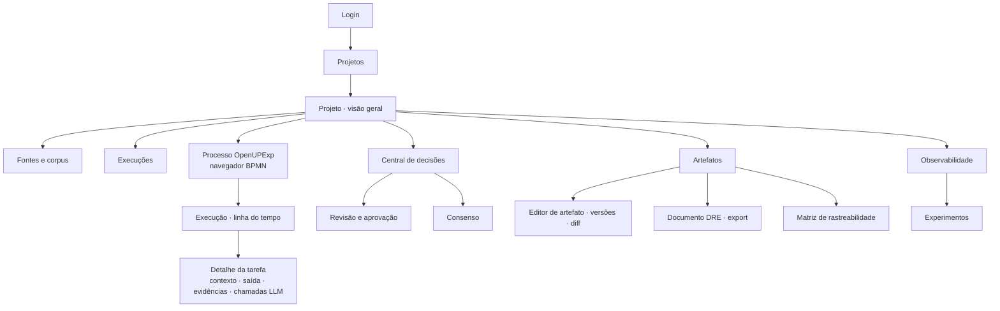

# 10 — Interface web

> **Em poucas palavras.** A interface foi pensada para quem conduz o processo, não para quem o
> programa: linguagem simples, uma cor e um ícone por etapa, avisos claros de "agora é com
> você" e os diagramas BPMN da teoria exibidos em português. A seção 10.0 descreve como ela é
> hoje [IMPLEMENTADO]; as seções seguintes guardam o desenho original [PROPOSTA], útil como
> registro das intenções.

## 10.0 Como a interface é hoje [IMPLEMENTADO]

### Identidade visual

- **Logo** do OpenUPExp: uma lupa sobre uma pequena rede — a ideia de "olhar dentro da IA"
  (`frontend/public/logo.svg` e `logo-horizontal.svg`).
- **Cores por etapa**: Visão (roxo), Elicitação (azul), Análise (laranja), Especificação (verde).
- **Ícones próprios** em todas as telas, sem biblioteca externa.
- **Tema claro e escuro**, alternável no menu lateral.

### Linguagem

Os termos técnicos foram trocados por expressões do dia a dia; o termo do processo aparece
como complemento quando ajuda a relacionar com a teoria.

| Termo técnico | Como aparece na tela |
|---|---|
| Fase 1 — Define Explainability Vision | Etapa 1 · Entender o problema (Visão) |
| Fase 2 — Elicit… | Etapa 2 · Ouvir as pessoas (Elicitação) |
| Fase 3 — Analyze… | Etapa 3 · Analisar e priorizar (Análise) |
| Fase 4 — Define Explainability Specification | Etapa 4 · Escrever a especificação (Especificação) |
| Central de decisões / HITL | O que precisa de mim |
| Gateway: revisitar 1.2 | Pedir para a IA refazer o desenvolvimento da visão |
| Objeção | Discordo |
| Lacuna | Informação faltando / ponto em aberto |
| Artefatos | Resultados por parte / partes do documento |
| Fontes, corpus, indexar | Documentos; preparar documentos para consulta da IA |
| Estratégia de contexto | Opções avançadas → "quanto do histórico a IA recebe" |

Os **nomes das tarefas** aparecem em português na lista de passos, nos painéis e **dentro dos
próprios diagramas**: a tradução é aplicada só na exibição, e os arquivos BPMN da teoria não
mudam. O painel de cada tarefa mostra também o nome original ("no processo: *Identify
Stakeholders*").

### Telas

| Tela | Para que serve |
|---|---|
| **Entrar** | Acesso, com a apresentação das quatro etapas |
| **Meus projetos** | Lista de projetos e criação de um novo |
| **Projeto → Etapas** | A **jornada das quatro etapas**, com a situação de cada uma ("concluída", "aguardando decisão", "pronta para começar") e o botão **Começar**, que já usa o resultado aprovado da etapa anterior. Inclui a lista "Antes de começar" e a escolha do modelo de IA |
| **Projeto → Documentos** | Envio do escopo, de leis, manuais, artigos e entrevistas; preparação para consulta |
| **Projeto → Equipe** | Pessoas e papéis (responsável pelos requisitos, participante, observador, pesquisador) |
| **Etapa** | Faixa de status ("A IA está trabalhando…", "Agora é com você"), mapa do processo, passo a passo, documento, resultados por parte e uso da IA |
| **Revisão / decisão** | Três passos do que fazer, partes do documento, verificação automática e as opções de decisão em cartões explicados |
| **O que precisa de mim** | As pendências da pessoa: aprovar, dar opinião ou enviar material |
| **Laboratório de modelos** | Comparações entre modelos e estratégias (cap. 14) |
| **Administração → Modelos de IA** | Cadastro e testes dos modelos (somente administradores) |

### Diferenças em relação ao desenho original

- Não usamos biblioteca de componentes nem gerador de formulários externos: os formulários de
  edição são gerados a partir do contrato BAML por um componente próprio (`SchemaForm`).
- O consenso é por rodada (uma posição por pessoa, com comentários por item), e não por voto
  em cada item como no rascunho D abaixo.
- A matriz de rastreabilidade aparece no documento da Etapa 4, não em tela separada.

## 10.1 Stack

| Camada | Escolha | Motivo |
|---|---|---|
| Build | Vite + React 18 + TypeScript | Padrão estável; SPA para desktop responsivo |
| Roteamento / dados | React Router + TanStack Query | Cache de servidor, *refetch* por evento SSE |
| BPMN | `bpmn-js` (NavigatedViewer) | Renderiza os `.bpmn` originais da teoria, com overlays e marcadores |
| Formulários de artefato | Componente próprio a partir do JSON Schema gerado do BAML | Nenhum formulário escrito à mão por artefato |
| Markdown | `react-markdown` + `remark-gfm` | Pré-visualização do Documento de Visão/DRE |
| UI | CSS e ícones próprios (E-06 resolvida) | Leveza e controle da linguagem visual |

**Licença do bpmn-js:** a licença exige manter visível a marca d'água do bpmn.io no
diagrama.

**Portal Bizagi:** `web/bizagi-publish` continua como documentação estática da teoria e
pode ser linkado. A plataforma usa os `.bpmn`, porque o export do Bizagi não contém os
elementos das páginas folha (I-12).

## 10.2 Mapa de navegação (desenho original)

O mapa atual é mais simples: menu lateral com **Meus projetos**, **O que precisa de mim**,
**Laboratório de modelos** e, para administradores, **Modelos de IA**.



## 10.3 Telas principais (rascunhos originais)

> Os wireframes usam dados **ilustrativos**: IDs, páginas, contagens e textos não são
> resultados reais de execução.

### A. Navegador do processo (BPMN + status da execução)

```
┌ Projeto: INPI Marcas ▸ Execução #7 (estratégia D · modelo X) ───────────── ● ao vivo ┐
│ [OpenUPExp] ▸ [1 Define Vision] ▸ [1.2 Develop]                     legenda: ✓ ● ⏸ ⚠ ↺ │
│ ┌──────────────────────────────────────────────────────────────┬────────────────────┐ │
│ │  (start)→[1.2.1 Needs ✓]→[1.2.2 Complementary ●]→            │ 1.2.2 Identify     │ │
│ │          [1.2.3 Limits ⏸]→[1.2.4 Elaborate ⏸]→(end)         │ Complementary Reqs │ │
│ │                    ║                                         │ Status: executando │ │
│ │             [(Reference Base)]                               │ Agente: Develop…   │ │
│ │                                                              │ Entradas: NEED×4   │ │
│ │  bpmn.io                                                     │ Trechos: 12 (híb.) │ │
│ │                                                              │ Tokens: 6.1k · 14s │ │
│ └──────────────────────────────────────────────────────────────┴────────────────────┘ │
│ Linha do tempo: 1.1.1 ✓ 1.1.2 ✓ 1.1.3 ✓ 1.1.4 ✓ 1.1.5 ✓ │ 1.2.1 ✓ 1.2.2 ● … │ iteração 2  │
└──────────────────────────────────────────────────────────────────────────────────────┘
```

- **Overlays** sobre os elementos BPMN, com status derivado de `task_execution`:
  concluído ✓, executando ●, aguardando ⏸, aguardando humano ✋, erro ⚠, *stale* ↺.
- **Clique em *call activity*:** abre o `.bpmn` do subprocesso (*drill-down*), com
  *breadcrumb*.
- **Clique em tarefa:** abre o painel lateral com o *manifesto* da tarefa (entradas,
  saídas, mecanismo) e a última execução.
- **Gateways:** mostram as decisões já tomadas em cada iteração (✓ aprovado / ↺ retorno
  para 1.2).

### B. Central de decisões (inbox)

```
┌ Decisões pendentes ─────────────────────────────────────────────────────────────┐
│ ✋ Aprovação  · 1.3 Explainability Vision approved? · Execução #7 · há 2 h        │
│ 🗳 Consenso   · 2.2.5 Reach Consensus · 3/5 votos · prazo 05/11 · 2 divergências │
│ ✋ Aprovação  · 1.3 … · Projeto Crédito · iteração 3 (alerta: muitas iterações)   │
└─────────────────────────────────────────────────────────────────────────────────┘
```

### C. Revisão e aprovação (gateway)

```
┌ 1.3 Review Explainability Vision · rascunho v3 ─────────────────────────────────────┐
│ Seções                │ §3.1 Resumo dos Stakeholders                    [editar] 💬 │
│ ✓ §1 Definição        │ STK-01 Examinador        descrição… responsabilidade…       │
│ ⚠ §2.1 Problema (1 lac)│ STK-02 Solicitante      descrição… ⚠ lacuna: responsab.   │
│ ✓ §2.2 Posicionamento │ STK-03 Regulador ...                                        │
│ ✓ §3.1 Stakeholders   │─────────────────────────────────────────────────────────────│
│ ⚠ §5 Complementares   │ Checklist automático (PreReviewChecklist)                   │
│   (1 sem evidência)   │ ✓ todo STK tem POS   ✓ todo NEED → STK   ⚠ CR-04 sem evid.  │
│ ✓ Limites             │ Lacunas: 3 (ver)                                            │
│ ✓ Glossário (14)      │─────────────────────────────────────────────────────────────│
│                       │ Decisão:  (•) Aprovar  ( ) Revisitar 1.1  ( ) Revisitar 1.2 │
│ [diff vs v2] [prévia] │ Comentário: ________________________________ (obrig. se ↺) │
│                       │                                             [Registrar]     │
└───────────────────────┴─────────────────────────────────────────────────────────────┘
```

- Os comentários 💬 são por seção ou item e alimentam o `review_feedback` (cap. 07).
- Uma edição inline gera uma versão `human_edit`. O diff mostra quem mudou o quê (IA ×
  humano).
- A aprovação fica bloqueada se houver versões `stale`.

### D. Consenso

```
┌ 2.2.5 Reach Consensus · rodada 1 · regra: sem objeção bloqueante · prazo 05/11 ─────┐
│ Participantes: Eng. Req (coord.) · Esp. Regulação ✓ · Esp. Domínio ✓ · Analista … ⏳ │
│ ┌──────────┬─────────────────────────────────────┬──────────┬───────────────────────┐ │
│ │ Item     │ Texto                               │ Votos    │ Seu voto              │ │
│ │ REQ-007  │ O sistema deve apresentar ao…       │ ✓✓✗      │ (✓) (✓*) (✗) 💬       │ │
│ │ REQ-008  │ …                                   │ ✓✓✓      │                       │ │
│ └──────────┴─────────────────────────────────────┴──────────┴───────────────────────┘ │
│ Divergências (IA · sugestão, requer aceite): REQ-007 — 2 comentários sobre "tempo…"   │
│ [Fechar consenso]  [Nova rodada]                                   (só Eng. Req.)     │
└──────────────────────────────────────────────────────────────────────────────────────┘
```

### E. Evidências

```
┌ CR-02 · Normas e Regulamentos ────────────────────────────────────────────────────┐
│ "O sistema deve permitir ao titular solicitar revisão de decisões automatizadas…" │
│ Necessidades: NEED-01, NEED-03                                                    │
│ Evidência 1 · OBRIGAÇÃO NORMATIVA · ✓ citação verificada                          │
│   lei_13709_lgpd · art. 20 · p. 12                                                │
│   "…o titular dos dados tem direito a solicitar a revisão de decisões tomadas…"   │
│   [ver trecho completo]  [Aceitar] [Rejeitar] [Reclassificar]                     │
└───────────────────────────────────────────────────────────────────────────────────┘
```

O trecho completo aparece com a citação destacada. Uma citação não verificada aparece
com uma faixa de alerta.

### F. Detalhe da tarefa (transparência do agente)

As abas são:

- **Contexto:** o `ContextPackage`, com cada item, sua origem (*required*, *digest*,
  *retrieved*, *related*, *feedback*) e o motivo de ter entrado. Inclui o relatório de
  cobertura.
- **Saída:** JSON e a renderização no template.
- **Chamadas LLM:** modelo, tokens, latência, custo, cadeia de fallback.
- **Histórico:** iterações anteriores desta tarefa.

### G. Observabilidade e experimentos

- Por execução: tokens e custo por tarefa (barras), latência, nº de iterações por
  subprocesso, nº de lacunas.
- Por experimento: matriz estratégia × caso × modelo com as métricas do cap. 09 e a
  variância entre repetições.
- **Exportação** de CSV/Parquet para análise externa (`experiments/analysis/`).

## 10.4 Componentes principais

| Componente | Responsabilidade |
|---|---|
| `<BpmnNavigator>` | Carrega o `.bpmn`, aplica overlays de status, faz drill-down e breadcrumb |
| `<RunTimeline>` | Execuções de tarefa por iteração, em tempo real via SSE |
| `<HitlInbox>` | Lista de `hitl_request` do usuário |
| `<ApprovalPanel>` | Decisão do gateway, com validações e comentário obrigatório |
| `<ConsensusBoard>` | Votos por item, política, rodadas, fechamento |
| `<ArtifactEditor>` | Formulário gerado do JSON Schema e destaque de lacunas |
| `<VersionDiff>` | Diff estrutural por item entre versões, com autoria |
| `<DocumentPreview>` | Markdown do template renderizado e export |
| `<EvidenceCard>` | Evidência com tipo, verificação e trecho original |
| `<ContextInspector>` | `ContextPackage` com origens, cobertura e tokens |
| `<TraceMatrix>` | Matriz de rastreabilidade a partir de `trace_link` (Fase 4) |
| `<MetricsDashboard>` | Gráficos de custo, latência, qualidade |
