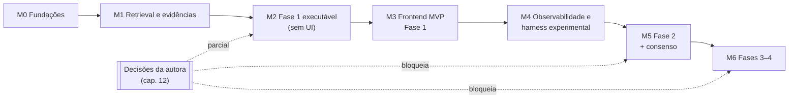

# 11 — Roadmap incremental, testes e riscos [PROPOSTA]

## 11.1 Roadmap

Os marcos são sequenciais. Cada um tem um critério de saída verificável. Datas não são
propostas aqui; dependem da disponibilidade da equipe e das decisões do cap. 12.

| Marco | Escopo | Critério de saída |
|---|---|---|
| **M0 Fundações** | `pyproject.toml` com versões fixadas; `generators.baml`; reorganização de diretórios e `legacy/`; `docker-compose` (db, api, worker, frontend vazio); Alembic; job runner com SKIP LOCKED; CI (lint, testes); correção do `"\\n"` (P-10) no legado | `docker compose up` sobe tudo; o legado roda e reproduz `blackboard.json`; teste da fila passa |
| **M1 Retrieval e evidências** | Ingestão com chunkers estruturais (lei, manual); `corpus_version`; embeddings escolhidos; busca híbrida RRF; filtro por referência explícita; verificação mecânica de citação | Conjunto de 20–30 consultas de teste com trechos esperados (ex.: "Art. 20 LGPD") — recall@10 medido e superior ao Chroma atual |
| **M2 Fase 1 executável** | Manifesto 0.1 da Fase 1 + teste manifesto↔BPMN; Artifact Store (versões, itens, dependências, invalidação); ContextBuilder C e D; contratos BAML novos da Fase 1; subgrafos 1.1/1.2/1.3 com `PostgresSaver`; `ApprovalGate` com `revisit_1_1`/`revisit_1_2`; API mínima + CLI para aprovar | Execução completa INPI: pausa em 1.3, retomada após reinício do worker, *revisit* 1.2 com invalidação correta, aprovação final, export `.md` no template da Visão |
| **M3 Frontend MVP** | Navegador BPMN com overlays; linha do tempo com SSE; inbox; tela de aprovação com edição e comentários; evidências; diff de versões; login e RBAC básico | Um Engenheiro conduz a Fase 1 inteira pela web, sem terminal |
| **M4 Observabilidade e experimentos** | `llm_call` via Collector; custos; ContextBuilder A e B; `experiment.batch`; pacote de reprodução; gabarito INPI da Visão; rubrica e avaliação humana; LLM-juiz calibrado | Experimento piloto: 4 estratégias × 1 caso × 5 repetições, com relatório de métricas e variância |
| **M5 Fase 2 + consenso** | Templates da Fase 2 (da autora); upload e ingestão de transcrições de elicitação; `ConsensusGate`; detecção de duplicatas por similaridade | Fase 2 do INPI concluída com um consenso real de ≥ 2 participantes |
| **M6 Fases 3–4** | Map/reduce por requisito; coverage guard `all_items`/`all_pairs`; conflitos e dependências; MoSCoW; histórias, critérios de aceitação, matriz de rastreabilidade derivada de `trace_link` | DRE completo do INPI; experimento das estratégias nas fases 3–4 |

**Fase 1 sem decisões da autora:** M2 pode começar com as interpretações de trabalho
documentadas no cap. 02. Se a autora decidir diferente, o impacto fica restrito ao
manifesto e a alguns contratos, porque a arquitetura não muda.

## 11.2 Estratégia de testes

| Nível | O que testar | Como |
|---|---|---|
| Unidade | Coverage guard; atribuição determinística de IDs; verificação de citação; RRF; política de consenso | pytest, sem LLM |
| Banco | Invalidação recursiva; ciclo de estados; unicidade de versão aprovada; idempotência do `hitl_request` | pytest + Postgres em container (testcontainers) |
| Fila | Concorrência (2 workers, 1 job); reaper de jobs órfãos; job único por `thread_id` | pytest com múltiplos processos |
| Grafo | Roteamento dos gateways; **retomada dupla** (resume reenviado não duplica efeitos); reinício do worker no meio de uma tarefa | LangGraph com **LLM falso** (cliente BAML apontando para servidor *stub* `openai-generic` que devolve fixtures) |
| Contrato | Prompts produzem os tipos; asserções de não invenção; snapshot de JSON Schema | `baml-cli test` + pytest |
| Conformidade | Todo elemento BPMN de referência está no manifesto e vice-versa; IDs existem nos `.bpmn` | pytest lendo `process/bpmn/*.bpmn` |
| Domínio | Prompts sem termos de domínio dos casos | *lint* em CI |
| Retrieval | Recall@k em conjunto de consultas anotadas; regressão ao trocar o chunker ou o embedding | script de avaliação versionado |
| Integração | `docker compose up` → executar Fase 1 com LLM falso → aprovar via API → export | pytest/httpx no CI |
| E2E | Fluxo do Engenheiro na UI (iniciar, acompanhar, revisar, revisitar, aprovar) | Playwright |
| Qualidade (pesquisa) | Métricas do cap. 09 | harness experimental (fora do CI) |

## 11.3 Riscos técnicos

| ID | Risco | Prob. | Impacto | Mitigação |
|---|---|---|---|---|
| R-01 | A teoria muda durante a implementação (templates, tarefas) | Alta | Médio | Manifesto versionado; execuções presas à versão; contratos com `schema_hash` |
| R-02 | Duas fontes de verdade (checkpoint × domínio) divergem | Média | Alto | Estado do grafo só com referências (cap. 04 §4.4); testes de reinício |
| R-03 | Efeitos duplicados na retomada de `interrupt()` | Média | Alto | Nó de gate sem efeitos; UPSERT idempotente; teste de retomada dupla |
| R-04 | Não determinismo do LLM invalida comparações | Alta | Alto | Repetições, temperatura fixa, sem fallback, registro completo |
| R-05 | Extração de PDF ruim (manuais extensos, páginas digitalizadas) | Média | Alto | Avaliar extração antes de M1; OCR se necessário; inspeção amostral dos chunks |
| R-06 | Provedor ou modelo descontinuado (já ocorreu: `gemini-1.5-flash`) | Alta | Médio | Perfis por papel; registro de versões; arquivamento das saídas brutas |
| R-07 | Custo de LLM nas fases 3–4 (map por requisito, pares) | Média | Médio | Geração de candidatos por similaridade; perfis baratos para tarefas simples; orçamento por execução |
| R-08 | Dados pessoais em transcrições de elicitação (LGPD) | Média | Alto | Consentimento; pseudonimização na ingestão; política de retenção; provedores com termos adequados |
| R-09 | Export BPMN com referências quebradas (I-02) quebra o viewer | Média | Baixo | Testar no bpmn-js; pedir re-export à autora; fallback para SVG do Bizagi |
| R-10 | Engessamento: o manifesto vira um "motor BPMN caseiro" | Média | Médio | Escopo explícito: apenas padrões usados pelo OpenUPExp (sequência, subprocesso, gateway de aprovação, consenso) |
| R-11 | Juiz LLM com viés | Média | Alto | Família diferente, calibração humana, cegamento |
| R-12 | Embedding pesado no worker (memória) | Baixa | Baixo | Serviço de embedding separado, se necessário |
| R-13 | Repositório pesado (PDFs e `chroma_db` versionados — P-15) | Alta | Baixo | Mover o corpus para o volume ou Git LFS; não versionar índices |

## 11.4 Decisões arquiteturais registradas (ADR resumido)

| ADR | Decisão | Status |
|---|---|---|
| ADR-001 | BPMN como referência + manifesto versionado; sem motor BPMN genérico | Proposta |
| ADR-002 | React + Vite + TS + bpmn-js; sem React Native | Aceita (equipe) |
| ADR-003 | Worker separado; fila em PostgreSQL; sem Redis | Aceita (equipe) |
| ADR-004 | PostgreSQL + pgvector + FTS; sem Elasticsearch | Aceita (equipe) |
| ADR-005 | BAML como fonte única de contratos | Aceita (equipe) |
| ADR-006 | Estado LangGraph somente com referências | Proposta |
| ADR-007 | ContextBuilder com estratégias A/B/C/D e coverage guard | Proposta |
| ADR-008 | Evidência com verificação mecânica de citação | Proposta |
| ADR-009 | HITL em dois mecanismos (aprovação × consenso) | Aceita (equipe); regra de consenso pendente da autora |
| ADR-010 | Markdown como export versionado; JSON tipado como fonte de verdade | Aceita (equipe) |
| ADR-011 | Observabilidade via BAML Collector + tabelas próprias | Proposta |
| ADR-012 | Conformidade processual e qualidade avaliadas separadamente | Proposta |
