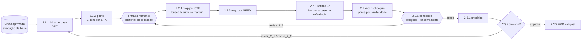

# 13 — Notas de implementação (M0–M3, Fases 2 e 3)

Este capítulo registra o que foi implementado e onde a implementação se afastou dos
capítulos anteriores, ou os detalhou. Todo o conteúdo aqui é **[IMPLEMENTADO]**, salvo
indicação em contrário.

## 13.1 O que existe

| Área | Onde | Observação |
|---|---|---|
| Manifesto 0.1.0 | `process/manifest/openupexp-0.1.0.yaml` | Fase 1 executável. Fases 2–4 registradas apenas para conformidade. `openupexp check-manifest` → **conforme** com os 17 `.bpmn` |
| Contratos BAML da Fase 1 | `backend/baml_src/` | 11 funções, com assinatura `(entrada, contexto)` e regras de não invenção herdadas dos workers originais |
| Grafo da Fase 1 | `backend/openupexp/agents/graph.py` | Gerado a partir do manifesto. O gateway 1.3 usa `interrupt()`, e o nó `_apply` faz o roteamento `approve` / `revisit_1_1` / `revisit_1_2` |
| ContextBuilder | `backend/openupexp/context/builder.py` | Estratégias A, C e D. **B levanta `NotImplementedError`** (marco M4) |
| Retrieval | `backend/openupexp/retrieval/` | Chunking por artigo (leis) e por seção (manuais), busca híbrida com RRF, referência explícita por metadado, citação verificada |
| Artefatos | `backend/openupexp/domain/artifacts.py` | Versões, itens com IDs estáveis, dependências, invalidação recursiva, links de rastreabilidade |
| Fila | `backend/openupexp/queue/jobs.py` | Implementação própria com SKIP LOCKED, sem `procrastinate` (E-03 continua aberto) |
| API | `backend/openupexp/api/` | JWT local, papéis por projeto, SSE com um único `LISTEN` mais *polling* de segurança |
| Interface | `frontend/` | Navegador BPMN com status e *drill-down*, central de decisões, revisão com edição e comentários por item, evidências, proveniência, diff, métricas |
| Testes | `backend/tests/` | 24 testes: unidade, banco, fila concorrente, fluxo completo com *revisit*, idempotência do gateway, API com RBAC, *lint* de domínio nos prompts |

## 13.2 Decisões tomadas durante a implementação

| # | Decisão | Motivo | Capítulo afetado |
|---|---|---|---|
| D-01 | Artefatos pertencem a uma **execução** (`artifact.run_id`). Fases futuras referenciam a execução anterior por `run.base_run_id` | Repetições experimentais do mesmo projeto não podem compartilhar artefatos | 06 |
| D-02 | A versão "atual" é sempre a de maior `version_no`. `superseded` só indica que existe versão mais nova | Simplifica as consultas e preserva os itens anteriores para a preservação de IDs | 06 §6.4 |
| D-03 | **Edição humana não invalida dependentes.** As dependências registradas continuam apontando para a versão que o agente efetivamente usou | Correções pequenas (texto, responsabilidade) não devem forçar retorno. A proveniência real é preservada. Se a mudança for estrutural, o revisor pede *revisit* | 07 §7.3 |
| D-04 | Ao preencher um campo, o revisor remove automaticamente a lacuna correspondente | Evita lacunas "fantasmas" no documento | 08 §8.2 |
| D-05 | Na **consolidação (1.3.2)**, o documento é remontado a partir das versões mais recentes, incluindo as edições humanas, e gravado como nova versão `vision.draft` aprovada | O rascunho de 1.2.4 não reflete edições feitas durante a revisão | 02 §2.5 |
| D-06 | No *revisit*, os artefatos do subprocesso refeito e dos posteriores ficam `stale`. Os anteriores voltam a `draft`. Os contadores de iteração avançam a partir do subprocesso escolhido | Segue a anotação do BPMN (I-01), sem a granularidade fina | 07 |
| D-07 | A coluna `embedding` não tem dimensão fixa (`vector`). O índice HNSW fica para quando o corpus justificar | Cada `corpus_version` pode usar um modelo diferente. Com cerca de 700 chunks, a varredura exata é rápida | 05, 06 |
| D-08 | O modelo padrão de embedding é `intfloat/multilingual-e5-base`, com prefixos `query:`/`passage:` | Resolve P-05 (limite de 128 tokens). A comparação com `bge-m3` continua em E-01 | 05 §5.7 |
| D-09 | Seções muito curtas de manuais (sumários) são fundidas com a seção seguinte | O manual de exame substantivo é quase todo sumário: sem a fusão, a mediana era de 55 caracteres | 05 §5.7 |
| D-10 | O *coverage guard* foi implementado no posicionamento (um por stakeholder, com uma nova tentativa) e nos limites (toda pergunta do checklist recebe resposta ou lacuna). Faltas persistentes falham a tarefa | As únicas tarefas da Fase 1 com completude exigida | 05 §5.5 |
| D-11 | O gateway simulado (`AGENT_GATEWAY=fake`) também gera `llm_call` (provedor `fake`) | Testes e demonstrações exercitam a observabilidade sem LLM | 09 |
| D-12 | O protótipo original foi movido para `legacy/` e continua executável (caminhos agora relativos ao próprio arquivo). Os PDFs do caso INPI foram para `experiments/cases/inpi/` (`escopo_projeto.pdf` e `corpus/`), compartilhados pelo protótipo e pela plataforma. Apenas P-10 foi corrigido em `legacy/main.py` | Raiz organizada conforme a estrutura do cap. 04, sem duplicar o corpus | 04 §4.6 |
| D-13 | A estratégia A anexa o documento integral atual a **todas** as tarefas, inclusive as determinísticas | Mantém a linha de base comparável: o pacote registra exatamente o que seria entregue | 05 §5.4 |

## 13.3 Limitações conhecidas

- **Execução com LLM real ainda não validada.** O caminho BAML existe e está coberto pela
  renderização offline do prompt (`b.request`), mas não foi executado de ponta a ponta sem
  chaves no ambiente. Primeiro passo de validação: `cp .env.example .env`, preencher uma
  chave, iniciar a Fase 1 com "LLM real".
- **Tabela de preços vazia.** Sem linhas em `model_price`, o custo fica nulo.
- **Fora desta entrega:**
  - consenso (`hitl_consensus`), previsto para M5;
  - estratégia B, harness de experimentos e gabaritos, previstos para M4;
  - exportação `.docx`/`.pdf` via pandoc.
- **Bundle do frontend:** cerca de 610 KB (bpmn-js). A divisão de código pode vir depois.
- **Avisos do bpmn-js:** os arquivos com referências quebradas (I-02) renderizam, mas geram
  avisos de importação no console do navegador.

## 13.4 Fase 2 — Elicitação (manifesto 0.2.0)

A Fase 2 é executável a partir de uma execução da Fase 1 **concluída e aprovada**
(`run.base_run_id`). Os formatos dos artefatos são provisórios (cap. 12 §12.4).

### Como a Fase 2 trata o problema de contexto

- **Material de elicitação indexado por execução.** Em 2.2.1, os documentos `elicitacao` do
  projeto viram um `corpus_version` próprio (`purpose = elicitation`, `run_id`), separado da
  base de referência. Cada stakeholder recebe **só** os trechos recuperados para ele
  (consulta = nome + perguntas do plano), em vez das transcrições inteiras.
- **Map por item.** 2.2.1 roda uma chamada por stakeholder e 2.2.2 uma por necessidade da
  Visão (mais uma para necessidades novas). `TaskContext.call(..., retrieved=refs)` filtra os
  trechos entregues a cada chamada; o pacote de contexto registra todos, com o motivo.
- **Joins determinísticos.** Toda RN precisa sustentar algum RI (2.2.2), e todo RI/RC precisa
  ser consolidado ou descartado com motivo (2.2.4). Faltas geram uma nova chamada só com os
  itens faltantes; se persistirem, a tarefa falha de forma visível.
- **Citações verificadas** contra o trecho do material ou contra a solicitação SN-n da Visão
  (`agents/evidence.py`, compartilhado com 1.2.2).

### Pontos de interação humana

| Tipo | Onde | Quem | Retoma o grafo? |
|---|---|---|---|
| `input` | antes de 2.2.1 (`2.2.1.in`) | Engenheiro envia material ou prossegue sem, justificando | sim |
| `consensus` | 2.2.5 | participantes registram posição; o Engenheiro encerra ou pede retorno | só o encerramento ou o retorno |
| `approval` | 2.3.gate | Engenheiro: aprovar, revisitar 2.1 ou 2.2 | sim |

### Decisões adicionais

| # | Decisão | Motivo | Capítulo afetado |
|---|---|---|---|
| D-14 | Manifesto **0.2.0**; execuções antigas continuam com o manifesto em que foram criadas (`get_manifest(run.manifest_version)`) | Reprodutibilidade: a Fase 1 não muda entre 0.1.0 e 0.2.0, mas isso não pode ser pressuposto | 04, 06 |
| D-15 | Entrada humana modelada como `human_input` da tarefa (nó de interrupção antes dela), e não como tarefa extra no manifesto | A conformidade com o BPMN continua 1:1; o BPMN mostra 2.2.1 "aguardando humano" | 07 |
| D-16 | Posições de consenso são `hitl_response` com `decision` = `concordo`/`ressalvas`/`objecao`; vale a última posição de cada pessoa. O encerramento grava a contagem em `hitl_request.payload.fechamento` | Sem tabela nova; histórico preservado | 06, 07 |
| D-17 | Em retornos, os comentários das posições de consenso entram no feedback entregue aos agentes | O BPMN não diz como o consenso realimenta 2.2; sem isso, a objeção se perderia | 05, 07 |
| D-18 | O ERD exportado em 2.3.2 inclui a Visão aprovada como Parte 1 | Interpretação de A-12; o digest cobre só a Parte 2 | 02, 08 |

### Limitações da Fase 2

- Formatos provisórios (A-14): mudanças da autora exigem novo manifesto e novos contratos BAML.
- Prazo do consenso (`due_days`) é registrado, mas não há lembrete nem encerramento automático.
- Não há atualização do Glossário na Fase 2 (cap. 12 §12.4).
- Validado com agentes simulados; o comportamento com LLM real ainda não foi medido.

## 13.5 Fase 3 — Análise (manifesto 0.3.0)

A Fase 3 parte de uma execução da Fase 2 concluída e aprovada. Interpretações em cap. 12 §12.5.

- **Cadeia de execuções.** `store.lineage()` percorre `base_run_id` (Fase 3 → 2 → 1): as
  entradas declaradas vêm da execução mais próxima que tenha o artefato, e os digests de
  **todas** as fases aprovadas entram como contexto auxiliar (estratégia D).
- **Map em lotes.** 3.1.2 roda uma chamada por requisito; 3.2.1, 3.2.2, 3.2.4 e 3.2.5 rodam em
  lotes de 6, cada lote só com os artefatos dos próprios requisitos (e, em 3.2.2/3.2.4, só
  os trechos recuperados para eles). `_per_requirement` garante uma saída por requisito,
  com nova tentativa para os faltantes, e preserva os IDs entre iterações.
- **Reduce.** 3.2.6 recebe uma visão compacta de todos os requisitos (aspecto, risco,
  viabilidade, conflitos, dependências) — é a única tarefa que precisa ver o conjunto.
- **Rastreabilidade.** Novos tipos de link: `refines` (análise → REQ), `conflicts_with`,
  `depends_on`.

| # | Decisão | Motivo |
|---|---|---|
| D-19 | Edição humana preserva campos de sistema fora do contrato (ex.: `cobertura_pares`, `sugestao_ia`) | Antes, editar o artefato apagava esses registros e quebrava o checklist |
| D-20 | Artefatos por requisito usam `req_id` como chave de correspondência entre iterações | IDs estáveis sem depender de similaridade de texto entre "REQ-01" e "REQ-02" |

Validação: fluxo completo coberto por teste (objeção → retorno a 3.2 com feedback → consenso →
aprovação → ERD com as três partes) e executado na interface com agentes simulados
(execução `519abefa`). Comportamento com LLM real ainda não medido.

## 13.6 Fase 4 — Especificação (manifesto 0.4.0)

A Fase 4 parte de uma execução da Fase 3 concluída e aprovada. Interpretações em cap. 12 §12.6.

- **Fichas em vez de documentos.** 4.1.2 junta, sem LLM, o requisito e os resultados da Análise
  numa ficha por requisito. As tarefas 4.2.1–4.2.3 recebem só as fichas do lote, e não o ERD
  acumulado — o tamanho da entrada depende do lote, não do histórico do projeto.
- **Map por requisito e por HU.** 4.2.1 roda em lotes de fichas e aceita várias HU por requisito
  (cobertura: ao menos uma). 4.2.2 e 4.2.3 rodam em lotes de HU, com `_per_requirement`
  generalizado para a chave `hu_id`. IDs das HU são preservados entre iterações pela dupla
  (requisito, stakeholder).
- **Rastreabilidade calculada.** A matriz (4.2.4) é montada a partir dos IDs, sem LLM; não há
  como o agente "esquecer" uma linha.
- **DRE.** 4.3.2 acrescenta a Parte 4 ao ERD aprovado da Fase 3 e exporta `dre-*.md`.

| # | Decisão | Motivo |
|---|---|---|
| D-21 | Prioridade fora do contrato da HU; vem da Análise aprovada pela ficha | Evitar que o agente altere uma decisão humana da Fase 3 |
| D-22 | Heurística de termos vagos no checklist 4.3.1 é só alerta | Boa prática do passo 2; a decisão continua humana |

Validação: fluxo completo coberto por teste (objeção → retorno a 4.2 com feedback e IDs
preservados → consenso → aprovação → DRE com as quatro partes). Comportamento com LLM real
ainda não medido.

## 13.7 Modelos de linguagem e modelo local (cap. 14, passo 1)

- Tabelas `llm_model` e `inference_profile` (migração `b7e3f1c2d4a6`); catálogo semeado por
  `openupexp/llm/catalog.py` na subida da API e ao iniciar execuções. O modelo local é restaurado
  a partir do seed (não aceita edição); os demais só são criados se faltarem.
- `run.model_profile` guarda o snapshot do perfil resolvido, com o `digest` dos pesos do Ollama.
- O worker monta o cliente com `ClientRegistry.add_llm_client` a partir do snapshot; a chave é
  lida da variável indicada em `api_key_env`, nunca gravada.
- O Ollama é **opcional** (perfil `local-llm` do Compose, `LOCAL_LLM_ENABLED`), com teto de CPU e
  memória. Desligado, o modelo local aparece indisponível e o padrão passa a ser a nuvem com reserva.

| # | Decisão | Motivo |
|---|---|---|
| D-23 | Variante Qwen3 4B Instruct-2507 (sem modo de raciocínio) | Evita o bloco de pensamento, que na CPU multiplica o tempo e atrapalha a saída estruturada |
| D-24 | Modelo local desligado por padrão | Máquinas sem GPU podem travar; ligar é uma decisão explícita da instalação |
| D-25 | Variante do modelo criada por Modelfile com `num_ctx` 16384 | O contexto padrão do Ollama é menor que os prompts da plataforma |

## 13.8 Administração de modelos (cap. 14, passo 2)

- Coluna `inference_profile.checks` (migração `c4d8e2a9f1b3`) com o resultado do teste de
  compatibilidade; o teste roda como job `llm.compat` no worker.
- O padrão efetivo é o perfil marcado, se utilizável; senão, `nuvem-com-reserva`.

| # | Decisão | Motivo |
|---|---|---|
| D-26 | `api_key_env` restrito a `*_API_KEY` / `*_TOKEN` | Impede que um cadastro aponte para outros segredos do servidor |
| D-27 | Perfil só é habilitado após teste de compatibilidade; mudanças no modelo invalidam o teste | O teste reflete exatamente a configuração em uso |
| D-28 | Teste de compatibilidade no worker, não na API | Com o modelo local, leva minutos; a API responde na hora e a tela acompanha |

## 13.9 Laboratório de modelos (cap. 14, passo 3)

| # | Decisão | Motivo |
|---|---|---|
| D-29 | Reexecutar o handler com o pacote guardado, e não reenviar prompts gravados | A plataforma não guarda as entradas das chamadas; o handler reconstrói as mesmas a partir do pacote e preserva o map/reduce e as verificações |
| D-30 | Trechos recuperados refeitos pelo handler, com verificação de igualdade | A busca é determinística para a mesma versão do corpus; a tela mostra quando não coincidir |
| D-31 | nginx resolve o nome da API a cada 10 s | Ao recriar a API, o frontend mantinha o IP antigo e respondia 502 |

## 13.10 Laboratório v2 e estratégia B (cap. 14, passo 4)

| # | Decisão | Motivo |
|---|---|---|
| D-32 | Estratégia B implementada no ContextBuilder, compartilhada por etapas e laboratório | Uma única definição do que "B" significa |
| D-33 | Estratégias do laboratório derivadas das versões do pacote original | Mantém fixo o estado dos artefatos; só A e digests ausentes usam o estado atual, e isso fica registrado |
| D-34 | Gabarito por (projeto, tarefa), com emparelhamento textual transparente | Primeiro nível, auditável na tela; LLM-juiz fica para depois |
| D-35 | Modelo do Gemini passou para `gemini-3.5-flash` | O `gemini-2.5-flash` foi descontinuado (404), detectado pelo teste de compatibilidade |

