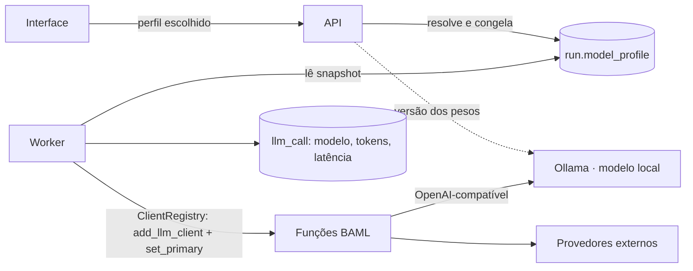
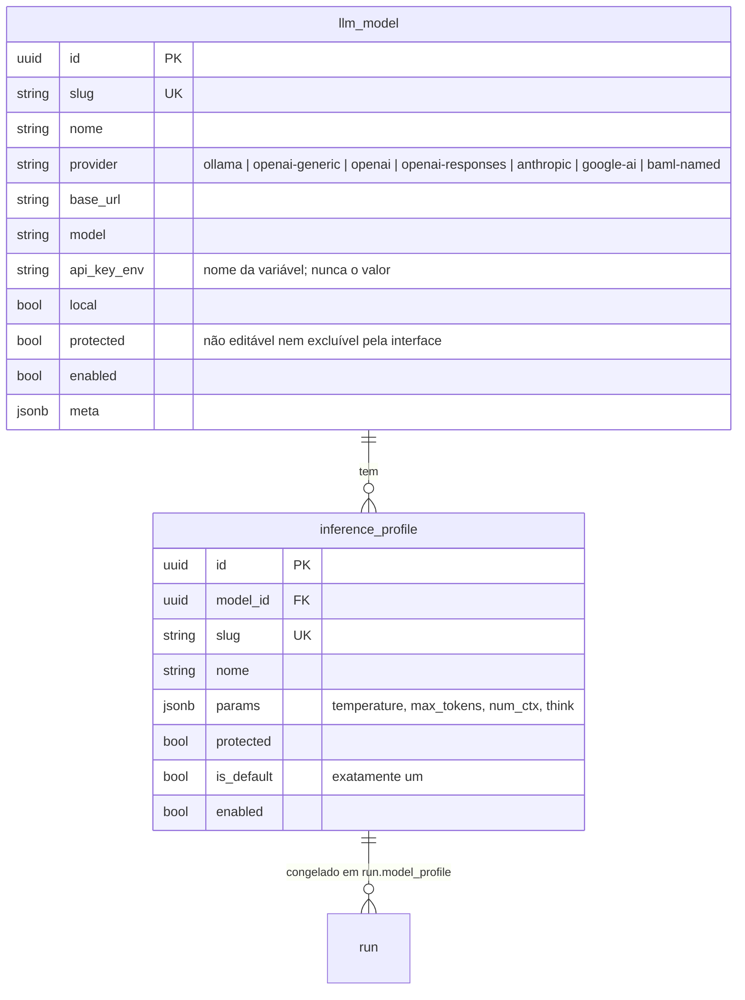

# 14 — Modelos de linguagem, modelo local e laboratório [PROPOSTA]

Este capítulo trata de **qual modelo de linguagem executa os agentes** e de como compará-los.
Nada aqui vem da teoria OpenUPExp: é decisão de arquitetura da plataforma.

| Passo | Entrega | Situação |
|---|---|---|
| 0 | Este capítulo: arquitetura, modelo de dados e plano | [IMPLEMENTADO] |
| 1 | Ollama opcional no Compose, modelo local protegido, escolha do perfil por execução, registro da configuração usada | [IMPLEMENTADO] |
| 2 | Administração de modelos e perfis, com teste de conexão, teste de compatibilidade e lista de servidores permitidos | [IMPLEMENTADO] |
| 3 | Laboratório v1: reexecutar tarefas reais com o mesmo pacote de contexto em vários modelos | [IMPLEMENTADO] |
| 4 | Laboratório v2: estratégias A–D (com a B), matriz modelo × estratégia, repetições, gabaritos | [IMPLEMENTADO] (1º nível de emparelhamento) |

## 14.1 Princípios

1. **Modelo local como referência (baseline), não como obrigação — e opcional na instalação.**
   Um modelo pequeno, executado na própria máquina via Ollama, vem cadastrado e protegido: não
   pode ser excluído nem ter a configuração-base alterada pela interface. Quando ligado, é o perfil
   padrão; cada execução pode usar outro modelo habilitado. Como ele é pesado sem GPU, a
   instalação pode **não** subi-lo (padrão): o cadastro continua, desligado, e o padrão passa a
   ser a "nuvem com reserva".
2. **Provedores externos continuam valendo.** Groq, OpenAI, Anthropic, Google e servidores
   compatíveis com a API da OpenAI (vLLM, Ollama remoto).
3. **Modelo ≠ perfil de inferência.** O modelo diz *onde* e *qual* (provedor, endereço, nome,
   chave). O perfil diz *como* (temperatura, limite de saída, tamanho de contexto, raciocínio).
   O mesmo modelo pode ter vários perfis.
4. **Configuração congelada por execução.** Ao iniciar uma execução, o perfil é resolvido e copiado
   para `run.model_profile` (snapshot). Editar o cadastro depois não altera o que a execução usou.
5. **Sem fallback silencioso em perfis cadastrados.** Uma execução com perfil escolhido usa só
   aquele modelo; falhas aparecem como falhas. O fallback entre famílias (`OpenUPExpDefault` em
   `clients.baml`) continua disponível como perfil "nuvem com reserva".
6. **Segredos fora do banco e do navegador.** O cadastro guarda só o *nome* da variável de
   ambiente com a chave (`api_key_env`). O valor é lido pelo worker.
7. **Contratos únicos.** Todos os modelos usam as mesmas funções BAML; a troca é feita com o
   `ClientRegistry` do BAML em tempo de execução, sem duplicar prompts.

## 14.2 Arquitetura



- **Ollama** é um serviço **opcional** do Docker Compose, no perfil `local-llm` (`ollama`,
  imagem fixada, volume `ollama_models`, teto de CPU e memória configurável). Um serviço de
  inicialização (`ollama-pull`) baixa o modelo e cria a variante da plataforma com os parâmetros
  do perfil (contexto de 16 mil tokens, temperatura 0).

### Ligar ou não o modelo local

| Situação | Configuração | Efeito |
|---|---|---|
| Máquina sem GPU / com pouca memória (padrão) | `LOCAL_LLM_ENABLED=false`; `docker compose up -d` | Ollama não sobe; modelo local aparece desligado; padrão = nuvem com reserva |
| Quer o modelo local | `LOCAL_LLM_ENABLED=true`; `docker compose --profile local-llm up -d` | Ollama sobe com teto `OLLAMA_CPUS` (4) e `OLLAMA_MEM_LIMIT` (6 GB); padrão = modelo local |
| Ollama em outra máquina (servidor com GPU) | `LOCAL_LLM_ENABLED=true`; `OLLAMA_URL=http://servidor:11434` | Nenhum container local; mesma interface |

A terceira linha é o caminho natural para a pesquisa: o modelo "local" roda em um servidor da
instituição, e as máquinas de desenvolvimento não carregam o modelo.
- O **worker** monta o cliente BAML a partir do snapshot (`provider`, `base_url`, `model`,
  parâmetros, chave lida de `api_key_env`) e o define como primário para todas as funções.
- A **API** registra, ao iniciar a execução, o identificador da versão dos pesos do modelo
  local (`digest` do Ollama), para auditoria.

### Modelo local inicial

O candidato inicial é o **Qwen3 4B Instruct-2507** quantizado em 4 bits
(`qwen3:4b-instruct-2507-q4_K_M`, 2,5 GB), da família Qwen3. O **Qwen3 8B** fica para comparação.
A escolha não foi feita por desempenho medido; a decisão final depende das medições (§14.6).

O Qwen3 "híbrido" tem um **modo de raciocínio** que gera um bloco de pensamento antes da resposta.
Na CPU isso multiplica o tempo e pode atrapalhar a leitura da saída estruturada. A variante
Instruct-2507 não tem esse modo, por isso foi escolhida. O parâmetro `think` fica registrado no
perfil para quando o laboratório comparar variantes com raciocínio.

## 14.3 Modelo de dados



Snapshot em `run.model_profile` (já existia; passa a ter estrutura definida):

```json
{
  "profile_id": "…", "profile_slug": "local-qwen3-4b", "profile_nome": "Qwen3 4B local",
  "model_slug": "qwen3-4b-local", "provider": "ollama", "base_url": "http://ollama:11434/v1",
  "model": "openupexp-qwen3-4b", "params": {"temperature": 0, "think": false},
  "api_key_env": null, "local": true, "model_digest": "sha256:…", "resolved_at": "…"
}
```

Planejado para o passo 3 (laboratório):

| Tabela | Conteúdo |
|---|---|
| `lab_comparison` | Tarefa, execução de origem, pacote de contexto reutilizado, perfis comparados, quem criou, situação |
| `lab_trial` | Uma tentativa por perfil: snapshot do perfil, saída bruta e validada, validade do contrato, cobertura, verificação das evidências, tokens, latência, custo, erro |
| `lab_rating` | Nota humana por tentativa (escala e critérios a definir com a autora) |

Alterações nos cadastros vão para `audit_log` (já existente), incluindo troca de versão dos pesos
do modelo local.

## 14.4 Administração (passo 2) [IMPLEMENTADO]

Tela **Administração → Modelos de IA** (`/admin/modelos`), visível só para o papel `admin`;
API em `/api/admin/llm`. Código: `backend/openupexp/llm/admin.py`.

- **Cadastro** de modelos (Ollama, compatível com OpenAI, OpenAI, Anthropic, Google) e de perfis
  (temperatura, limite de resposta, contexto, raciocínio), com validação de faixas.
- **Servidores permitidos**: o endereço precisa estar em `LLM_ALLOWED_HOSTS` (vazio = lista padrão:
  Ollama local, Groq, OpenAI, Anthropic, Google), porque os agentes enviam trechos dos documentos.
- **Chaves**: o cadastro guarda só o nome da variável, que precisa terminar em `_API_KEY` ou
  `_TOKEN`. Sem essa regra, um cadastro poderia enviar outro segredo do servidor (por exemplo
  `JWT_SECRET`) a um endereço externo como se fosse a chave.
- **Teste de conexão** (na API, sem conteúdo de projeto): lista os modelos do servidor e indica se
  o modelo cadastrado aparece.
- **Teste de compatibilidade** (no worker, pela fila): chama `DefineExplainabilityProblem` com um
  escopo fixo e neutro de domínio, pelo mesmo `ClientRegistry` das execuções. Aprova se a saída é
  aceita pelo contrato e identifica ao menos um stakeholder. Registra tempo, tokens, versão dos
  prompts (`baml_src_sha`) e dos pesos (`digest`).
- **Habilitar só depois de passar no teste.** Modelos novos nascem com o perfil desabilitado;
  mudar o modelo, o endereço ou os parâmetros invalida o teste e desabilita o perfil.
- **Padrão**: o administrador escolhe o perfil padrão das novas etapas (inicialmente o local). Se o
  padrão escolhido não estiver utilizável (ex.: modelo local desligado), vale a nuvem com reserva.
- **Proteção**: o modelo local e seu perfil não podem ser editados nem excluídos, mas podem ser
  testados e escolhidos como padrão. Toda alteração vai para `audit_event`.

Verificado com o modelo local real: conexão em 28 ms; compatibilidade aprovada em 85 s
(714/505 tokens, 3 stakeholders identificados).

## 14.5 Laboratório (passos 3 e 4)

### Implementação do passo 3 [IMPLEMENTADO]

Tela **Pesquisa → Laboratório de modelos** (`/laboratorio`), também acessível pelo botão
"Comparar modelos nesta tarefa" no painel de uma tarefa. Código: `backend/openupexp/lab/service.py`.

- **Como a tarefa é refeita.** O laboratório executa o *handler* da tarefa com o pacote de contexto
  guardado, sem os itens que o próprio handler acrescenta durante a execução (trechos recuperados e
  relacionados). O handler refaz a busca sobre a mesma versão do corpus e o mesmo embedder; a
  tentativa registra se os trechos coincidiram com os da execução original ("mesmos trechos
  recuperados"). Quando coincidem, o material de entrada é idêntico; quando não, a diferença fica
  visível em vez de contaminar a comparação em silêncio.
- **Sem efeitos colaterais.** Gateway próprio (não grava `llm_call` na execução original) e sessão
  de banco desfeita no fim: nenhuma versão de artefato é criada. Há teste automatizado para isso.
- **Tabelas** `lab_comparison`, `lab_trial` e `lab_rating` (migração `d9a1b5c3e7f2`). Cada
  tentativa guarda o snapshot do perfil, a saída, as métricas e as chamadas.
- **Fila**: uma tentativa por job (`lab.trial`); com um worker, rodam uma de cada vez (o modelo local
  em CPU não suporta paralelismo). Tentativas na fila podem ser canceladas.
- **Métricas automáticas**: formato aceito (contrato), itens produzidos, itens que faltaram, pontos
  em aberto (lacunas), citações conferidas, mesmos trechos recuperados, chamadas, tokens, tempo.
  A execução original entra como coluna de referência, com as mesmas métricas.
- **Nota humana**: 1 a 5 por tentativa, uma por pessoa, com comentário opcional e média.
- **Aviso de versão dos prompts**: se `baml_src` mudou desde a execução original, a tela avisa que
  a coluna de referência usou outra versão dos prompts.
- **Acesso**: membros do projeto veem; responsáveis pelos requisitos, pesquisadores e
  administradores criam comparações.

Verificado com o modelo local: tarefa 1.1.2 (INPI) — formato aceito, 4 stakeholders, mesmos
trechos, 1.643/959 tokens, 220 s; a mesma tarefa no modo simulado, como controle.

### Implementação do passo 4 [IMPLEMENTADO]

- **Estratégia B** no ContextBuilder (`semantic_select`): para cada entrada em lista, mantém os
  `B_TOP_K` (8) itens mais próximos da descrição da tarefa (nome, função BAML, referência teórica),
  na ordem original. A perda fica em `coverage.missing_ids` e **não é corrigida** (cap. 05). Vale
  para as etapas (opção "Busca por semelhança — experimental") e para o laboratório.
- **Estratégia como fator do laboratório**: cada tentativa tem `strategy` (vazio = pacote original).
  `derive_package` monta o pacote da estratégia a partir das **mesmas versões** que a tarefa recebeu;
  digests (D, quando o pacote original não os tinha) e documento integral (A) são os **atuais** da
  execução, e a tentativa registra isso em `contexto.estado_atual`.
- **Repetições** (1 a 5) intercaladas — uma rodada completa de modelos × estratégias antes da
  próxima — e **resumo por configuração** com média ± desvio padrão. Limite de 30 tentativas.
- **Gabarito** (`lab_gold`), por projeto e tarefa: lista de itens esperados de uma parte do
  documento, com campo de autoria. Emparelhamento 1:1 guloso por semelhança textual (limiar 0,6),
  com precisão, cobertura (recall) e F1; a tela mostra cada par, os faltantes e os extras para
  conferência. É o primeiro nível do emparelhamento previsto no cap. 09 (humano ou LLM-juiz).
- **Exportação CSV** de uma linha por tentativa, para análise estatística externa.

Verificado com modelos reais (tarefa 1.1.2, INPI; gabarito **de teste**, não de especialistas):

| Modelo | Estratégia | Itens | F1 (teste) | Pontos em aberto | Tokens (lidos/escritos) | Tempo |
|---|---|---|---|---|---|---|
| GPT-5 mini | como executada | 4 | 100% | 7 | 1.460 / 4.081 | 39,8 s |
| Gemini 3.5 Flash | como executada | 4 | 100% | 7 | 1.620 / 1.331 | 20,1 s |
| GPT-5 mini | C | 4 | 100% | 6 | 1.460 / 3.399 | 28,6 s |
| Gemini 3.5 Flash | C | 4 | 100% | 7 | 1.620 / 1.382 | 24,6 s |

Uma execução por configuração e um caso pequeno: não permite conclusões, só confirma o fluxo.

**Limitações**: o emparelhamento textual erra com sinônimos e paráfrases (por isso a conferência
na tela); o LLM-juiz e a concordância entre especialistas (α de Krippendorff) continuam pendentes;
a estratégia A usa o documento atual, não o do momento da tarefa.

### Plano original

Objetivo: comparar modelos **com tudo o mais fixo**.

- **Reexecução com o mesmo pacote de contexto.** Cada tarefa executada já guarda o pacote de
  contexto que o agente recebeu (`context_package`). O laboratório reexecuta a tarefa X da
  execução Y com esse mesmo pacote em N perfis. Entradas, trechos recuperados, prompt (versão de
  `baml_src`) e evidências ficam idênticos; muda só o modelo.
- **Fila e concorrência.** As tentativas passam pela fila do PostgreSQL com limite de
  concorrência por modelo (1 para o modelo local em CPU) e podem ser canceladas.
- **Métricas automáticas** (já disponíveis na plataforma): validade do contrato, uma saída por
  item esperado (cobertura), verificação mecânica das citações, tokens, latência, custo.
- **Avaliação humana**: nota por tentativa no próprio laboratório. Precisão e cobertura em
  relação a uma resposta correta dependem de gabaritos, previstos no M4 (cap. 09 §9.4).
- **Passo 4**: comparar estratégias de contexto A/B/C/D (a B ainda não existe) separadamente e em
  matriz cruzada com os modelos, para detectar interação entre os fatores.

### Pergunta de pesquisa possível [PROPOSTA]

> Até que ponto modelos pequenos executados localmente produzem artefatos de engenharia de
> requisitos de explicabilidade com qualidade, conformidade ao processo e rastreabilidade
> comparáveis às de modelos comerciais, sob diferentes estratégias de contexto?

Registrada como sugestão. Incluí-la no estudo é decisão da pesquisadora e da autora da teoria.

## 14.6 Medições no ambiente de desenvolvimento

Máquina de desenvolvimento: 8 núcleos, 30 GB de RAM, sem GPU dedicada; Ollama 0.34.4 sem teto
de CPU. Uma única função (1.1.1 `DefineExplainabilityProblem`) com o escopo do caso INPI,
chamada pelo mesmo caminho do worker (`ClientRegistry`, perfil local):

| Medição | Tempo total | Tokens (entrada/saída) |
|---|---|---|
| 1ª chamada (modelo carregando) | 169 s | — |
| 2ª chamada (modelo em memória) | 95 s | 1.277 / 706 (~8 tokens/s na saída) |

Observação qualitativa (uma amostra, não é avaliação): a saída respeitou o contrato BAML e
identificou os quatro stakeholders, mas deixou a maior parte dos campos vazia, com lacunas,
alegando que o escopo não trata de explicabilidade. É o comportamento conservador pedido pelas
regras de não invenção, levado ao extremo — exatamente o tipo de diferença que o laboratório
deve medir contra modelos maiores.

Estimativa para uma etapa: a Fase 1 faz ~10 chamadas com entradas maiores que esta; na CPU, algo
entre 20 e 40 minutos com o modelo em memória. É estimativa, não medição.

## 14.7 Riscos

| Risco | Mitigação |
|---|---|
| Modelo local lento em CPU | Usado como referência; perfis externos para uso diário; laboratório com fila |
| Contexto do Ollama menor que o prompt (padrão de poucos milhares de tokens) | Variante do modelo criada com contexto explícito; alerta quando o prompt estimado excede |
| Saída fora do contrato em modelos pequenos | Parser tolerante do BAML; teste de compatibilidade antes de habilitar; falha visível |
| Endpoint cadastrado vazar documentos | Lista de servidores permitidos; cadastro restrito a `admin`; auditoria |
| Comparações injustas por diferenças de RAG | Reexecução com o mesmo pacote de contexto |
